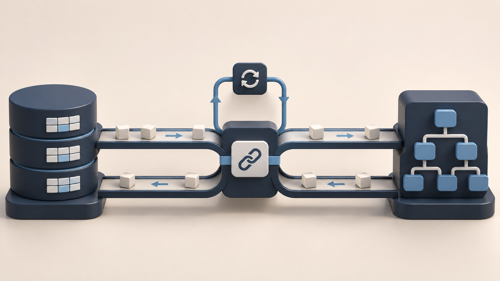

# Artem Serdiuk

### Backend, full-stack and integration engineering

I build API integrations, document pipelines and internal tools, taking projects from requirements through implementation, testing and handoff. My strongest work deals with identity, workflow state, background processing and recovery when external systems fail.

Based in **Ukraine**. Open to remote work and discussing relocation within Europe.

[Visual portfolio](https://megumax.github.io/MeguMax/) · [LinkedIn](https://www.linkedin.com/in/artem-serdiuk-4a3a15334/) · [Upwork](https://www.upwork.com/freelancers/~014b478981bfacdaf1) · [CV](assets/CV-Artem-Serdiuk-EN.pdf) · [Portfolio PDF](assets/Engineering-Portfolio-EN.pdf)

## Three main engineering cases

### 1. Upwork workflow platform

I built an internal workspace that brings job discovery, qualification, reusable project evidence, AI-assisted preparation and human review into one workflow. The difficult part was keeping the right account, source facts and reviewed draft together while external calls, background jobs and operator edits happened at different times.

**JavaScript ES modules · Node.js 20+ · Express5 · PostgreSQL/pg · Model Context Protocol SDK · OAuth2.1/PKCE**

[Architecture, decisions and screenshots](case-studies/integration-platform.md)

### 2. Legal document workflow

I built a document operations platform that turns incoming emails and PDFs into isolated case drafts. It preserves reviewers' corrections, pins documents to reviewed versions and verifies external saved bundles before reporting preparation complete.

**TypeScript · Node.js · SQLite WAL · Microsoft Graph · Azure Identity · OneDrive**

[Architecture, decisions and screenshots](case-studies/legal-workflow.md)

### 3. PatientNow ↔ GoHighLevel

I built a TypeScript integration backend that keeps contacts, appointments, provider calendars and blocked time aligned across PatientNow and GoHighLevel. It also maps PatientNow orders and refunds into CRM opportunities. The engineering focus is predictable behaviour when events are duplicated, delayed, missing or interrupted by an external API failure.

**TypeScript · Node.js · Fastify · Axios · Zod · AWS SQS FIFO**

[Architecture, decisions and screenshots](case-studies/patientnow-ghl.md)

## More selected work

- **LeafSplit — AI model development:** I work with the LeafSplit team on AI model development, training experiments and evaluation. My work includes experimental tooling, automated checks and comparisons with baseline models, with an emphasis on reproducible results.
- **Candidate Management Dashboard — [view](https://github.com/MeguMax/test-task-for-JotSolutions):** A recruitment dashboard with candidate cards, status changes, filters and a shared skill catalog. I used validated Express endpoints and Prisma transactions for related records, with optimistic React updates and rollback when requests fail.
- **Shared wishlists and realtime groups — [view](https://github.com/MeguMax/wishlist-app):** A React/TypeScript application for shared wishlists, gift reservations, group contributions and realtime chat. It combines authenticated flows, relational data, image storage and realtime subscriptions through Supabase.
- **Shared lead intake and agent routing:** I worked on a shared GoHighLevel intake flow used by several forms and landing pages. The work covered field mappings, assigned-agent routing and notifications that retain complete application details, including updates to existing contacts.
- **Shopify storefront and funnel compatibility:** I worked on product and variant behaviour across a Shopify storefront and funnel links, checking that focused changes preserve the cart, subscriptions and the purchase path expected by the existing integration.
- **CRM-KP sales workspace — [view](https://github.com/MeguMax/CRM-KP):** A sales-workflow application with client forms, a dashboard and Kanban-style pipeline. The source includes React/TypeScript state management, Express controllers, MongoDB models and Slack/email service modules.
- **Notion → GoHighLevel workflow automation — [view](https://www.upwork.com/freelancers/~014b478981bfacdaf1?p=2110337539072770048):** A published Upwork portfolio example of connecting Notion and GoHighLevel through Make. It adds evidence of low-code automation alongside custom backend engineering.
- **HostShield frontend — [view](https://github.com/MeguMax/hosthield-develop):** Historical frontend work for a waiver-management product, including role-specific dashboards, document and review flows, account screens and a marketing website. The repository remains a code example after the product closed.
- **Payment-triggered onboarding and course access — [view](https://www.upwork.com/freelancers/~014b478981bfacdaf1?p=1990431490445197312):** A one-page course-sales funnel connecting Stripe checkout to GoHighLevel CRM updates, tags and access-email workflows through Zapier and webhooks. The published portfolio describes responsive forms and follow-up email/SMS sequences; course content and client details remain private.
- **White-label CRM interface customization — [view](https://www.upwork.com/freelancers/~014b478981bfacdaf1?p=2054642433408012288):** Customized a white-label GoHighLevel workspace using JavaScript, reusable CSS and responsive interface patterns. The published case covers navigation, dashboards, smart lists, pipelines and role-aware visibility across sub-accounts, with reusable branding and interaction states.
- **Interactive mortgage intake — [view](https://www.upwork.com/freelancers/~014b478981bfacdaf1?p=2105280224797556736):** An interactive mortgage enquiry flow that captures service intent, property details, indicative financing needs and timing before collecting contact information and consent. The published case describes a Vue.js single-page interface on AdsQuiz with GoHighLevel integration-ready lead delivery and segmentation workflows.

[Read project scope and implementation details](case-studies/more-work.md) · [Client automation examples](case-studies/client-automations.md)

## AI development

**Backend Lead at LeafSplit, October 2026–Present.** I work with the team on AI-model development, training experiments and reproducible evaluation using Python, NumPy and PyTorch experiments. Private model architecture and unreleased findings remain outside this portfolio.

## Background and contact

Software Engineering, Kherson National Technical University · expected graduation 2027.

**artom.serdyuk.600@gmail.com**

My Upwork profile showed **100% Job Success, $6K+ earnings, 3 total jobs and 180 hours on 4 November 2026**. These are dated profile statistics, separate from the scope of individual projects.

Cover images are conceptual illustrations. Architecture diagrams and actual interface screenshots are labelled in each case. Public repositories may be earlier snapshots; test records are dated and do not imply complete live end-to-end verification.
