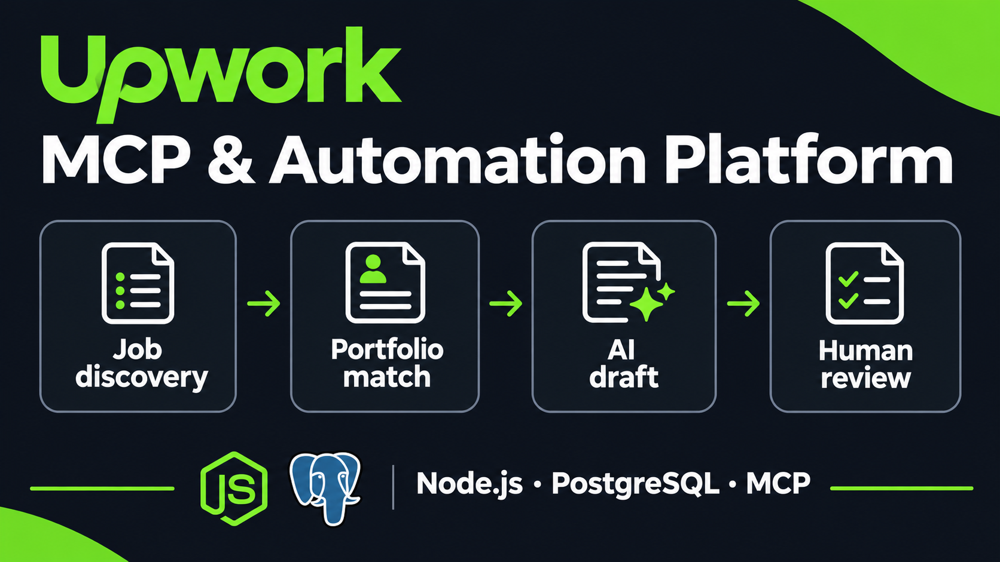
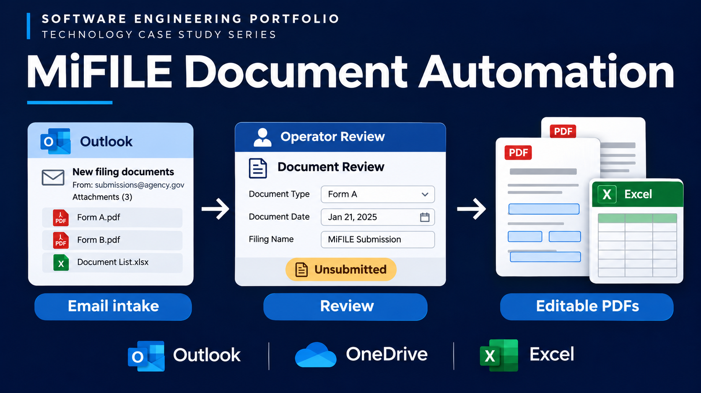
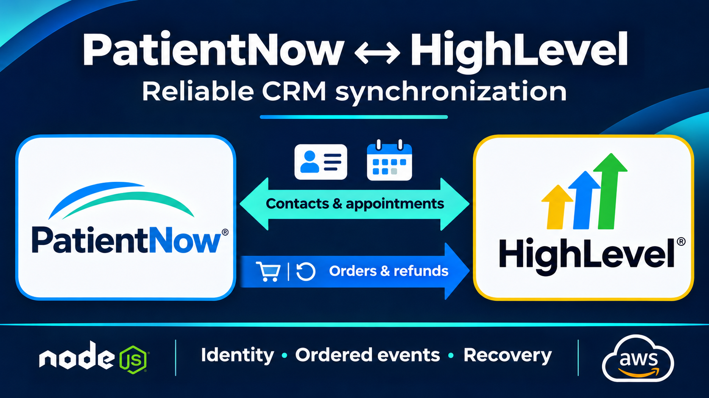

# Artem Serdiuk

### Backend, full-stack and integration engineering

I build software that helps teams prepare proposals, review legal documents and keep business records aligned. I focus on workflows where people can check the source material, keep their corrections and recover when a task stops.

Based in **Ukraine**. Open to remote work and discussing relocation within Europe.

[Visual portfolio](https://megumax.github.io/MeguMax/) · [LinkedIn](https://www.linkedin.com/in/artem-serdiuk-4a3a15334/) · [Upwork](https://www.upwork.com/freelancers/~014b478981bfacdaf1) · [CV](assets/CV-Artem-Serdiuk-EN.pdf) · [Portfolio PDF](assets/Engineering-Portfolio-EN.pdf)

## Three main engineering cases

### 1. Upwork workflow platform

I built a single workspace for finding relevant opportunities, reusing project evidence and reviewing AI-assisted proposal drafts before delivery.

**User problem:** Preparing a proposal requires the job details, the right work profile, relevant project examples and a draft that someone has checked. Those details can change while preparation is running. The operator needs to see what was used and keep their corrections when a background task finishes.

**Practical benefit:** Operators can find a job, reuse relevant evidence and review a draft in one place. Each draft retains its source references, and manual corrections stay separate from the original AI output. If preparation stops or a remote result is uncertain, the operator can see that state and check before repeating an action.

**Implementation:** JavaScript ES modules · Node.js 20+ · Express5 · PostgreSQL/pg · Model Context Protocol SDK · OAuth2.1/PKCE.

[Architecture, decisions and screenshots](case-studies/integration-platform.md)

### 2. Legal document workflow

I built a workflow that turns emailed legal documents into case packages reviewers can check and correct, with editable PDFs generated from Excel.

**User problem:** Legal staff need to prepare the right documents for each case and check the details before a package is ready. One email can include several cases, incomplete fields and attachments that need clarification. When processing continues during review, corrections and source versions need to stay together.

**Practical benefit:** Reviewers can inspect extracted fields beside each case's source documents and keep their corrections as processing continues. A failed document can be retried without blocking another case that is ready for preparation. Excel-based PDF generation produces editable documents for review.

**Implementation:** TypeScript · Node.js · SQLite WAL · Microsoft Graph · Azure Identity · OneDrive.

[Architecture, decisions and screenshots](case-studies/legal-workflow.md)

### 3. PatientNow ↔ GoHighLevel

I built a synchronization backend designed to keep contact and appointment records consistent between PatientNow and GoHighLevel, with checks for repeated events and recovery from missed updates.

**User problem:** Staff working in PatientNow and GoHighLevel need the same contact details and appointments in both places. Different record identifiers, repeated notifications and missed changes make it difficult to know which record to update.

**Designed benefit:** The service is designed to reduce entering the same contact or appointment twice. It checks whether a change has already been handled and periodically compares records to catch missed updates. Unclear matches and conflicting edits are reported for review.

**Implementation:** TypeScript · Node.js · Fastify · Axios · Zod · AWS SQS FIFO.

[Architecture, decisions and screenshots](case-studies/patientnow-ghl.md)

## More selected work

- **LeafSplit — AI model development:** I work with the LeafSplit team on AI model development, training experiments and evaluation. My work includes experimental tooling, automated checks and comparisons with baseline models, with an emphasis on reproducible results.
- **Candidate Management Dashboard — [view](https://github.com/MeguMax/test-task-for-JotSolutions):** A recruitment dashboard with candidate cards, status changes, filters and a shared skill catalog. I used validated Express endpoints and Prisma transactions for related records, with optimistic React updates and rollback when requests fail.
- **Shared wishlists and realtime groups — [view](https://github.com/MeguMax/wishlist-app):** A React/TypeScript application for shared wishlists, gift reservations, group contributions and realtime chat. It combines authenticated flows, relational data, image storage and realtime subscriptions through Supabase.
- **Shared lead intake and agent routing:** I worked on a shared GoHighLevel intake flow used by several forms and landing pages. The work covered field mappings, assigned-agent routing and notifications that retain complete application details, including updates to existing contacts.
- **Shopify storefront and funnel compatibility:** I worked on product and variant behaviour across a Shopify storefront and funnel links, checking that focused changes preserve the cart, subscriptions and the purchase path expected by the existing integration.
- **CRM-KP sales workspace — [view](https://github.com/MeguMax/CRM-KP):** A sales-workflow application with client forms, a dashboard and Kanban-style pipeline. The source includes React/TypeScript state management, Express controllers, MongoDB models and Slack/email service modules.
- **HostShield frontend — [view](https://github.com/MeguMax/hosthield-develop):** Historical frontend work for a waiver-management product, including role-specific dashboards, document and review flows, account screens and a marketing website. The repository remains a code example after the product closed.

[Read project scope and implementation details](case-studies/more-work.md) · [All 19 Upwork portfolio entries](case-studies/upwork-client-portfolio.md) · [Client automation examples](case-studies/client-automations.md)

## AI development

**Backend Lead at LeafSplit, October 2026–Present.** I work with the team on AI-model development, training experiments and reproducible evaluation using Python, NumPy and PyTorch experiments. Private model architecture and unreleased findings remain outside this portfolio.

## Background and contact

Software Engineering, Kherson National Technical University · expected graduation 2027.

**artom.serdyuk.600@gmail.com**

My Upwork profile showed **100% Job Success, $6K+ earnings, 3 total jobs and 180 hours on 4 November 2026**. These are dated profile statistics, separate from the scope of individual projects.

Cover images are conceptual illustrations. Architecture diagrams and actual interface screenshots are labelled in each case. Public repositories may be earlier snapshots; test records are dated and do not imply complete live end-to-end verification.
