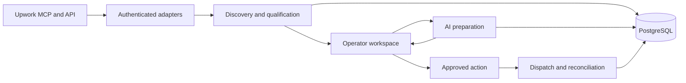

# Upwork integration and proposal workspace

An internal application for job discovery, portfolio matching, AI-assisted preparation and operator-controlled API actions. I designed and implemented the backend, browser interface, workflow state, integrations, tests and release tooling.

The application uses **JavaScript ES modules, Node.js, Express and PostgreSQL**. Its operator interface is HTML/CSS/JavaScript. React and TypeScript are used in my other projects, not this interface.

## Workflow

## Engineering decisions

### Authentication and account context

MCP connections support OAuth discovery, dynamic client registration and PKCE. Tokens are encrypted per connection, and competing refresh requests share one in-flight operation. Discovery context and the identity allowed to act are kept separate.

### Persistent state and concurrent changes

PostgreSQL transactions, row locks and revision checks protect workflow changes. Long-running work rechecks its source version before updating a draft, preserving newer manual edits. An uncertain database commit stops further processing until the outcome can be reconciled.

### Discovery and portfolio evidence

Versioned scanners combine provider search with local matching rules, deduplicate results and coordinate rate limits and cooldowns. Capability profiles and portfolio records retain their source context. The portfolio knowledge layer extracts source-linked information; it is not a vector-search or model-training claim.

### AI preparation

The OpenAI Responses API produces schema-constrained proposal packages and screening answers. The server checks evidence identifiers, source freshness and business constraints after generation. Missing or unsupported facts remain review items.

### Approval and external outcomes

An approved action is bound to saved inputs, identity and revision. A durable claim is recorded before dispatch, and duplicate-action locks remain in place when the result is uncertain. Provider acknowledgement and independent delivery readback are separate states.

### Operator experience and intake

The browser workspace covers scanners, qualification, profiles, sources, drafts, feedback and conversations. Stale-response protection prevents late requests from replacing another working draft. An optional read-only IMAP source implements MIME parsing, recipient mapping, deduplication, quarantine and atomic progress checkpoints.

## Validation and scope

- The recorded full regression run on **2 November 2026 passed 3,831 Node tests**. The saved run was matched to the source/test snapshot during review. The suite includes fixtures and mocked providers; this is not a coverage percentage or a count of live end-to-end tests.
- Bounded operator-approved pilot actions were checked through independent readback of core proposal fields. This does not establish contracts, revenue or complete verification of every optional provider field.
- Docker release checks include targeted Linux validation with network access disabled and preservation checks for existing state and dependent services.
- The IMAP implementation was tested and installed, but a live mailbox and polling were not activated in the reviewed acceptance evidence.
- HubSpot remained a review queue. A completed live CRM writer, full individual-user RBAC product and production-scale throughput are not claimed.

## Technologies

JavaScript, Node.js, Express, PostgreSQL, MCP SDK, OAuth/PKCE, Zod, OpenAI Responses API, ImapFlow, mailparser and Docker/Compose.

The application source is private. This public summary contains architecture and engineering scope without client records, credentials or internal endpoints.
