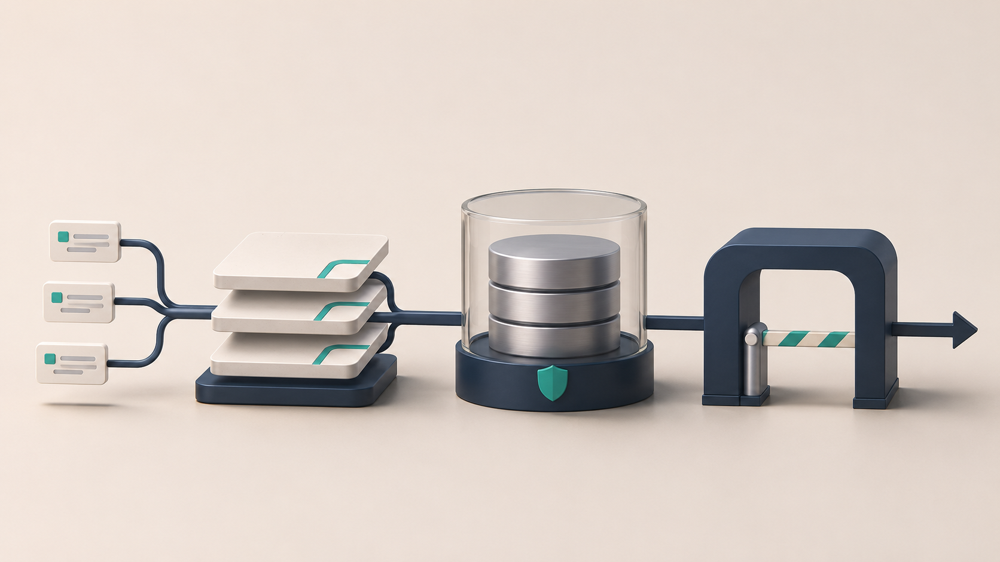
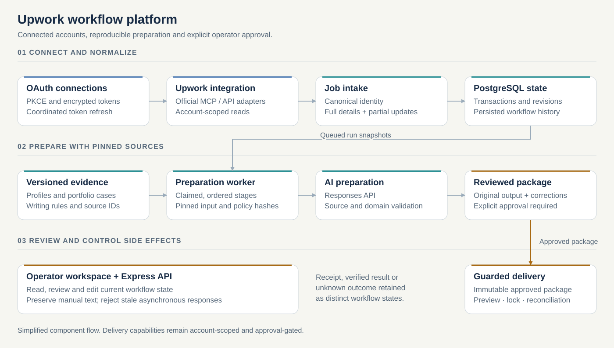
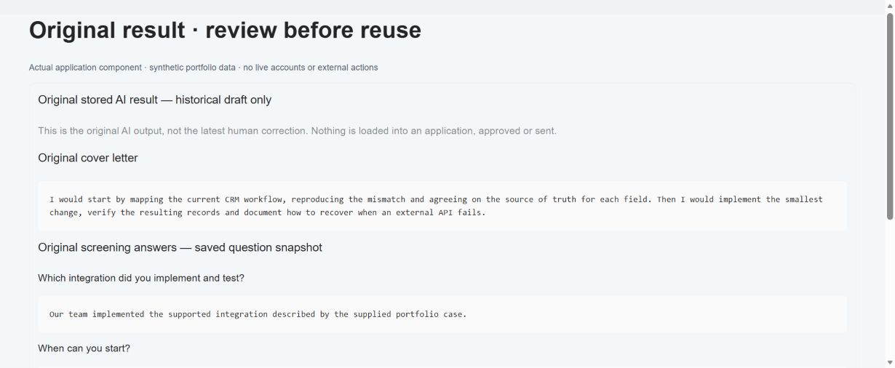

# Upwork workflow platform

AI-assisted operations

I built an internal workspace that brings job discovery, qualification, reusable project evidence, AI-assisted preparation and human review into one workflow. The difficult part was keeping the right account, source facts and reviewed draft together while external calls, background jobs and operator edits happened at different times.

**My role:** Independent developer — backend, operator UI, integrations, testing and release tooling

**Technology:** JavaScript ES modules, Node.js 20+, Express5, PostgreSQL/pg, Model Context Protocol SDK, OAuth2.1/PKCE, OpenAI Responses API, Zod/JSON Schema, HTML/CSS and vanilla JavaScript, Docker.

## The problem

The initial requirement was an OAuth/MCP bridge for an existing automation workflow. The application expanded into a dedicated business tool with persistent workflow state, versioned rules, source-bound preparation and an operator workspace.

## Architecture

Simplified implementation diagram, not a screenshot of production infrastructure.

## Engineering decisions

### Bind authentication to the correct connection

Implemented OAuth discovery and PKCE, encrypted per-connection token storage, account-to-connection routing and single-flight refresh. Concurrent requests share the same refresh operation instead of racing a rotating refresh token.

### Treat persistence uncertainty as a state, not a retry instruction

Used transactional PostgreSQL updates, a locked metadata row and revision-aware snapshots. If a COMMIT response becomes ambiguous, the store stops and requires reconciliation instead of silently falling back to old JSON or replaying a write.

### Make long-running preparation reproducible

Added a durable run ledger with pinned input and policy hashes, version checks, ownership and ordered stages. Interrupted runs remain visible. A draft can be traced back to the specific job facts, profile, rule version and portfolio evidence used to create it.

### Validate AI output against server-owned evidence

The model selects permitted evidence identifiers. The server resolves the original quotes and applies domain rules after schema validation. Unsupported experience, missing sources and unknown commitments remain blocked or explicitly unknown; human corrections are stored separately from original model output.

### Preserve richer records during partial refreshes

Separated complete job details from lower-confidence search observations. Equivalent money formats, reordered lists and contained description snippets do not replace authoritative fields. Meaningful contradictions flag a refresh while preserving the original draft and history.

### Separate preparation, approval and remote delivery

Built immutable application packages, account-scoped previews, duplicate-send locks and delivery states that distinguish acknowledgement, verified delivery and unknown outcomes. The UI preserves unsaved manual text and rejects stale asynchronous responses.

## Interface and workflow

Actual component renderer and styling, populated with synthetic portfolio data. Isolated demonstration; no live account, AI request or application submission.

## Validation and scope

- **5,388 passing tests.** Saved regression run dated 6 November 2026. A separate, overlapping Linux run passed 1,987 tests with outbound networking disabled; the counts are not added.
- **A bounded performance experiment.** For one saved record, payload size changed from 545,987 to 71,343 bytes. Median read time changed from 2,300.4 to 1,325.7 ms across three GET requests before and after. This is a single-record comparison, not a production-wide benchmark.

The platform prepares and reviews work with guarded provider operations. A prepared package, acknowledged request and independently verified remote result remain separate states. Shared operator authentication and process-local coordination are current architectural constraints.

Application source is private. This public case describes a sanitized architecture.

The saved test and acceptance records are dated evidence, not new runs performed for this portfolio.

[All selected work](../README.md) · [Visual portfolio](../index.html)

Updated 6 November 2026. Cover: conceptual illustration.
