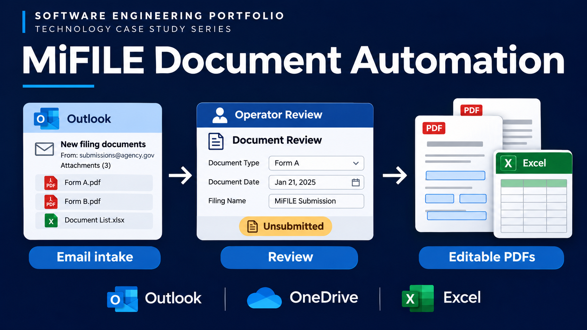
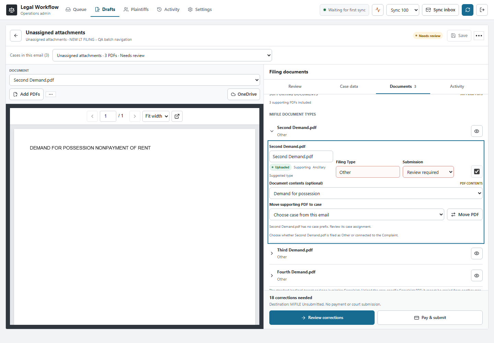
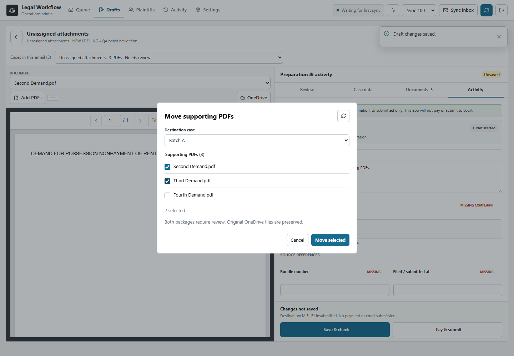
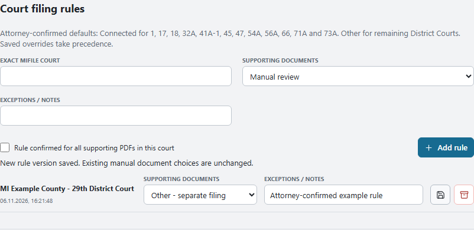
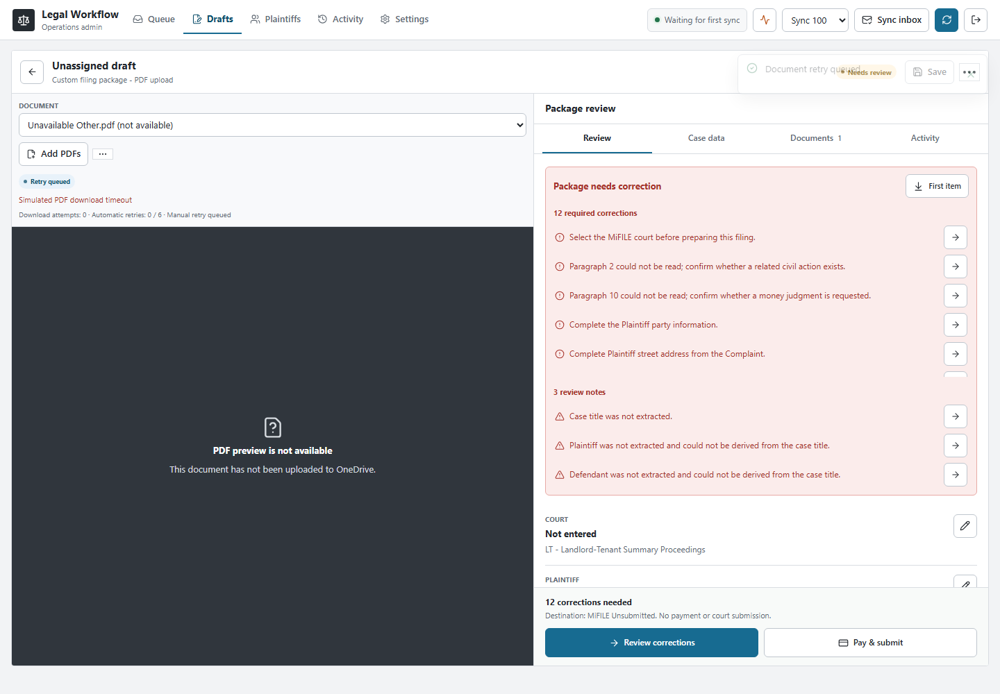
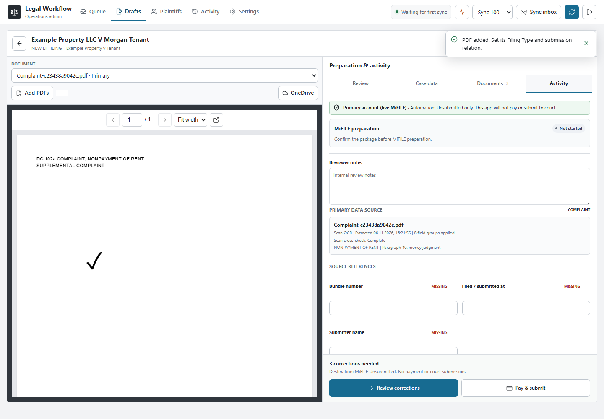
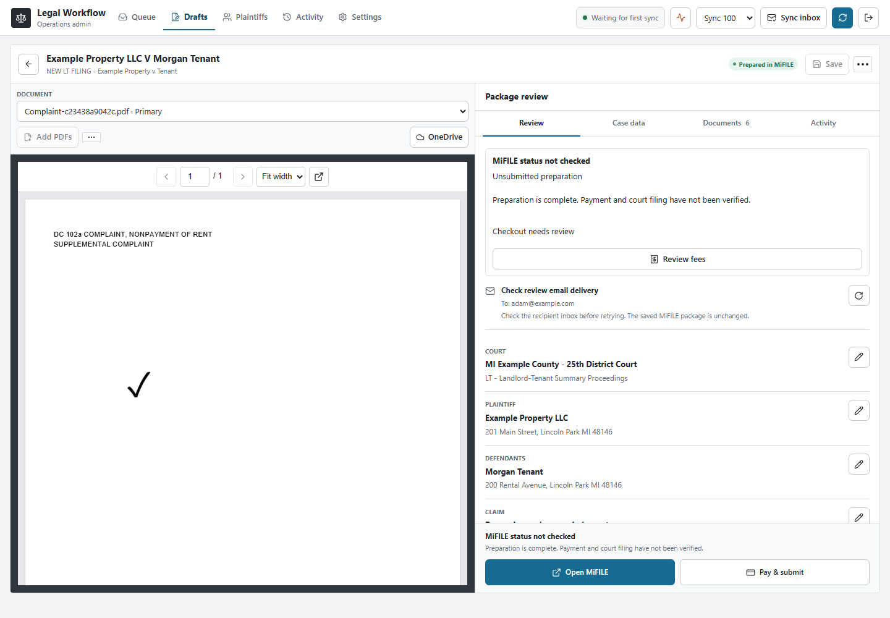
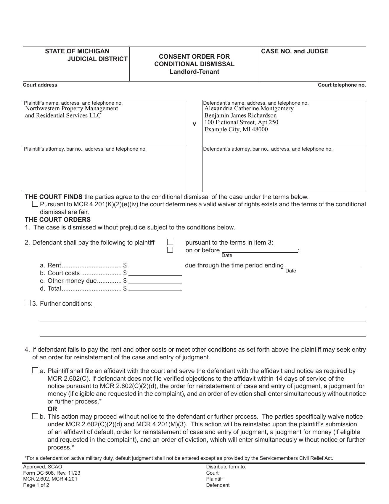
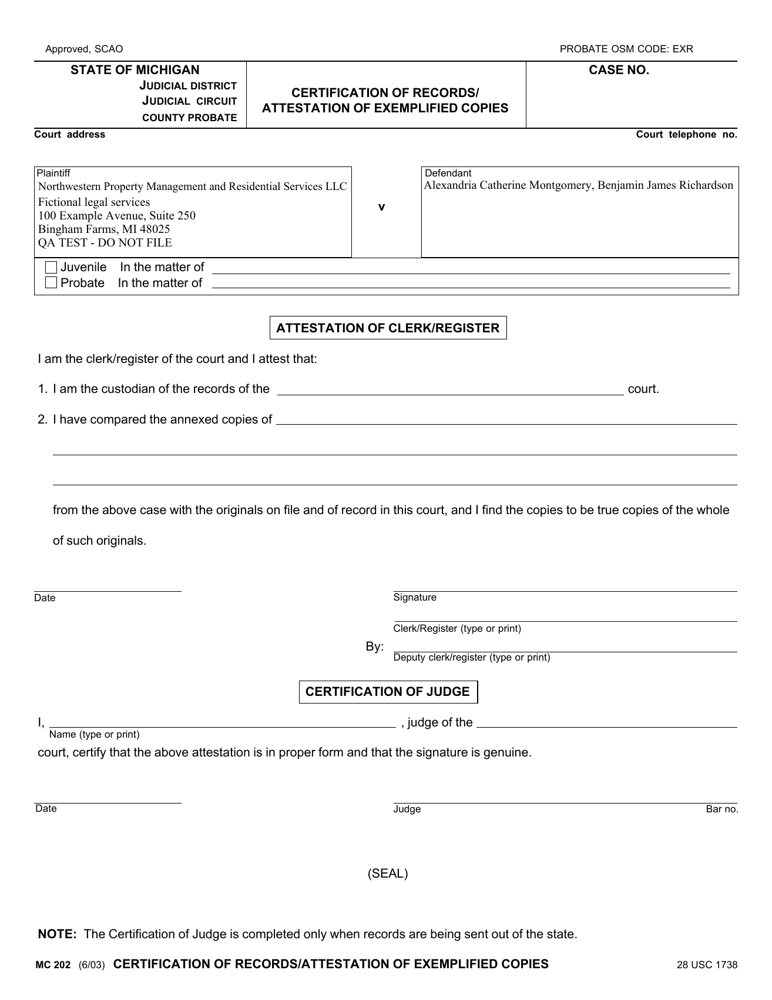

# Legal document workflow

Legal document review

I built a workflow that turns emailed legal documents into case packages reviewers can check and correct, with editable PDFs generated from Excel.

## User problem

Legal staff need to prepare the right documents for each case and check the details before a package is ready. One email can include several cases, incomplete fields and attachments that need clarification. When processing continues during review, corrections and source versions need to stay together.

## Practical benefit

Reviewers can inspect extracted fields beside each case's source documents and keep their corrections as processing continues. A failed document can be retried without blocking another case that is ready for preparation. Excel-based PDF generation produces editable documents for review.

## Implementation

**My role:** Sole full-stack engineer — application design, backend, admin interface, document pipeline, Microsoft integrations, browser preparation and Excel add-in.

**Technology:** TypeScript, Node.js, SQLite WAL, Microsoft Graph, Azure Identity, OneDrive, Playwright, PDF.js, Tesseract OCR, Office.js, Python, pypdf, reportlab, Docker, HTML/CSS/JavaScript.

## Architecture

Simplified implementation diagram, not a screenshot of production infrastructure.

## Engineering decisions

### Treat each case as an independent unit

Several packages from one email retain separate source documents, review state, form choices, audit trails and job payloads. Ambiguous attachments stay visible in a review group. A failed attachment in one case does not block an otherwise complete sibling case.

### Merge extraction around human corrections

Field-level protection preserves manually edited and intentionally blank values. Before an asynchronous result is applied, the worker rechecks source identity, replacement version and draft state. A late result cannot reopen or overwrite a changed package.

### Pin the documents that were actually reviewed

Immutable SHA-256-addressed form files and source-content fingerprints connect a draft, its selected form version and the job snapshot. Replacing or changing a PDF invalidates earlier extraction/preparation assumptions.

### Reconcile uncertain external writes

The worker persists checkpoints, verifies filing-type mappings and reopens the saved bundle to compare it with the source snapshot. If saving may have happened but cannot be confirmed, the workflow requires reconciliation rather than automatically creating another bundle. Graph read retries are bounded and explicitly separate from uncertain writes.

### Generate PDFs from live Excel state

The Office.js task pane waits for calculation completion, reads selected rows and rechecks row/sheet identity after asynchronous work. A Python worker generates fillable PDFs and validates field values, widget appearances and text fit. Selection changes invalidate old output.

### Keep email delivery independent and observable

A persistent notification outbox is tied to a verified prepared bundle. Duplicate or stale notifications are rejected; interrupted delivery becomes uncertain so the operator can check before resending. Workflow state, retry history and audits persist in SQLite WAL.

## Interface and workflow

Actual application UI with synthetic QA data: several independent cases share one intake email while unassigned supporting PDFs remain visible for review.

Actual application UI with synthetic QA data: document preview and guided package corrections.

Actual application UI with synthetic QA data: moving selected supporting PDFs to another case preserves original OneDrive files and requires review of both packages.

Actual application UI with synthetic QA data: extracted fields retain visible source labels and manual review controls.

Actual application UI with synthetic QA data: background preparation checkpoints and document verification progress. This is not a real court submission.

Actual application UI with synthetic QA data: bounded document-recognition retries stop with an actionable review state.

Generated editable-PDF example rendered for inspection. All populated parties and contact details are fictional QA data; do not file.

Actual application UI with synthetic QA data: versioned court rules preserve existing manual document choices.

Actual application UI with synthetic QA data: a simulated download timeout is visible alongside bounded retry status and actionable corrections.

Actual application UI with synthetic QA data: the operator can distinguish OCR-derived source fields and cross-check completion from later preparation or submission state.

Actual application UI with synthetic QA data: uncertain notification delivery stays separate from the saved preparation package and prompts inbox review before retry.

Rendered generated PDF with fictional QA fields. A template-output example, not a real legal record or filing.

Rendered generated PDF with fictional QA fields, visibly labelled QA TEST - DO NOT FILE.

## Validation and scope

- **87 source PDFs.** A saved offline multi-case acceptance report dated 6 November 2026 exercised 87 PDFs and recorded unchanged original source files. This is acceptance scope, not production throughput.
- **Editable PDFs from desktop Excel.** A saved Windows Excel acceptance record dated 29 October 2026 verified four generated PDFs, 126 compared field values and five rendered pages using fictional QA cases.

The evidenced external workflow prepares and verifies Unsubmitted bundles. Completed payments and final court submissions are not claimed. Screenshots show the real application with synthetic QA data.

The public repository is a source snapshot. The current case also describes newer local implementation.

[View the public source snapshot](https://github.com/MeguMax/Adam-automatization)

The saved test and acceptance records are dated evidence, not new runs performed for this portfolio.

[All selected work](../README.md) · [Visual portfolio](../index.html)

Updated 7 November 2026. Cover: conceptual illustration.
