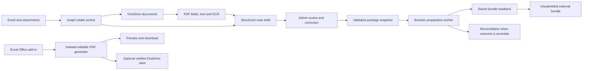

# Legal Workflow Automation Platform

An application for legal document intake, review, case preparation and Excel-driven PDF generation. Developed end-to-end by **Artem Serdiuk**.

The platform brings email and document processing into an operator workspace: incoming PDFs become structured drafts, people review and correct the data, and background workers carry out the next permitted steps with persistent status and recovery history.

## Core workflow



## What the application does

- Receives and classifies relevant emails, discovers PDF attachments and maintains a persistent processing queue.
- Stores documents in OneDrive and creates structured case drafts with validation and review states.
- Extracts typed PDF form values, positioned text and scanned content; keeps extraction warnings and source identity visible.
- Provides a custom admin interface for queue search, draft editing, PDF previews, document replacement, review, retry and activity history.
- Maintains court-specific form and filing-rule versions without silently replacing the version already selected by a draft.
- Prepares document packages through Playwright and checks the saved external result against the reviewed source snapshot.
- Generates editable legal PDF forms from the currently selected, calculated Excel row using an Office.js task pane.

## Engineering decisions

### Preserve human edits during background work

Automatic extraction merges into the latest persisted draft. Field-level edit tracking protects manual corrections and deliberately blank values. Replacing a source document invalidates extraction work already in flight, and a rejected or locked draft cannot be reopened by a late background result.

### Recover from uncertain remote outcomes

Jobs keep checkpoints and a snapshot of their case data. A failed save may already have created a remote bundle, so the application records a reconciliation-required state instead of blindly repeating the operation. Preparation verifies document types, source PDF fingerprints and the reopened saved bundle.

### Pin forms and documents to reviewed versions

The form library uses immutable, SHA-256-addressed PDF content. Drafts retain their selected version, while new active versions remain available for later work. Approval and queuing are transactional and reject stale or duplicate requests.

### Read live Excel values

The add-in waits for Excel's calculation state, reads the selected row and lets Excel format date serials. It rechecks the sheet and row after asynchronous work so that a PDF cannot be generated from a silently changed selection.

### Verify interactive PDFs

An isolated Python worker fills the packaged templates and preserves editable form fields. Generation checks canonical field values, page widgets, appearance streams, checkboxes and text fit. Oversized input, spreadsheet errors, ambiguous dates and clipped text return actionable errors.

### Keep work observable and recoverable

SQLite with WAL persists processing state, review decisions, retry history, job snapshots and audit events. OCR runs in a resource-bounded child process. Graceful shutdown coordinates the HTTP server, intake, extraction and preparation workers.

## Technology

| Area | Implementation |
|---|---|
| Application | TypeScript, Node.js, custom HTML/CSS/JavaScript admin UI |
| Persistence | SQLite, WAL, schema migrations, transactions |
| Microsoft integration | Microsoft Graph, Azure Identity, OneDrive |
| Browser integration | Playwright, checkpointed preparation and remote readback |
| Document processing | PDF.js, Tesseract OCR, positioned-text and form-field extraction |
| Excel integration | Office.js task pane, selected-row mapping, live recalculation checks |
| PDF generation | Python, pypdf, reportlab |
| Delivery | Docker and persistent-disk deployment configuration |

## Repository guide

- `src/adminServer.ts` — admin interface, API routes and operational views.
- `src/database.ts` — domain state, migrations, validation, snapshots, audit and recovery.
- `src/index.ts` and `src/filingIntakeWorker.ts` — email/document intake and retry processing.
- `src/complaintExtractor.ts`, `src/draftExtraction.ts` and `src/draftFieldMerge.ts` — extraction orchestration and manual-edit preservation.
- `src/formLibrary.ts` — versioned forms and document integrity checks.
- `src/mifileFilingRunner.ts` and `src/filingWorker.ts` — external preparation and reconciliation.
- `excel-addin/` — Office task pane, row mapping and session client.
- `src/excelPdf.ts`, `src/excelPdfDelivery.ts` and `tools/excel_pdf/` — validated interactive PDF generation and optional cloud delivery.
- `EXCEL_PDF_ADDIN.md`, `INTAKE_WORKFLOW.md` and `DEPLOY_RENDER.md` — setup, workflow and acceptance documentation.

## Validation

The regression suite covers workflow state transitions, stale and duplicate requests, manual-edit preservation, PDF replacement, restart recovery, authentication, Graph failures, browser classification and saved-result verification. Excel/PDF tests cover calculation readiness, selection changes, session isolation, form-field validation and uncertain cloud writes.

The repository also contains synthetic-data acceptance records for desktop Excel and generated PDF readback. These distinguish automated tests, real Office checks and customer rollout steps.

```bash
npm ci
npm run build
npm test
```

Use the Node.js version specified in `package.json`. The PDF-specific tests require a Python runtime with `pypdf`, `openpyxl` and `reportlab`; select it with `EXCEL_PDF_PYTHON`. Live Outlook, OneDrive, Office and external filing integration require authorized configuration and are separate from local regression tests.

## Operational scope

The current external automation prepares and verifies **unsubmitted** bundles. Payment and final court submission are deliberately separate from preparation. Customer account configuration and Microsoft 365 deployment follow the project-specific rollout process.

## Developer

**Artem Serdiuk** — full stack development, integrations and workflow automation.

[GitHub](https://github.com/MeguMax) · [LinkedIn](https://www.linkedin.com/in/artem-serdiuk-4a3a15334/) · [Email](mailto:artom.serdyuk.600@gmail.com)
