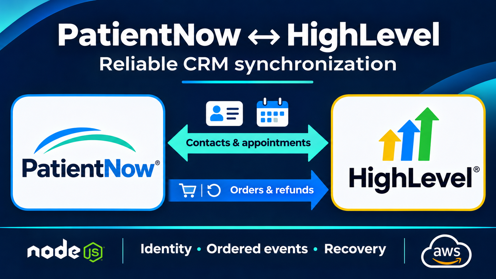
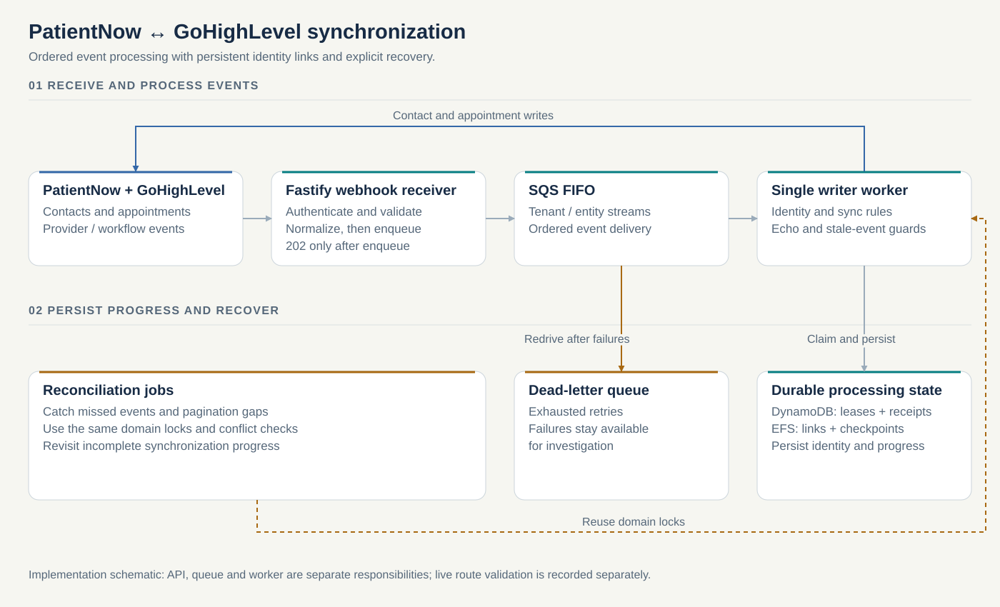
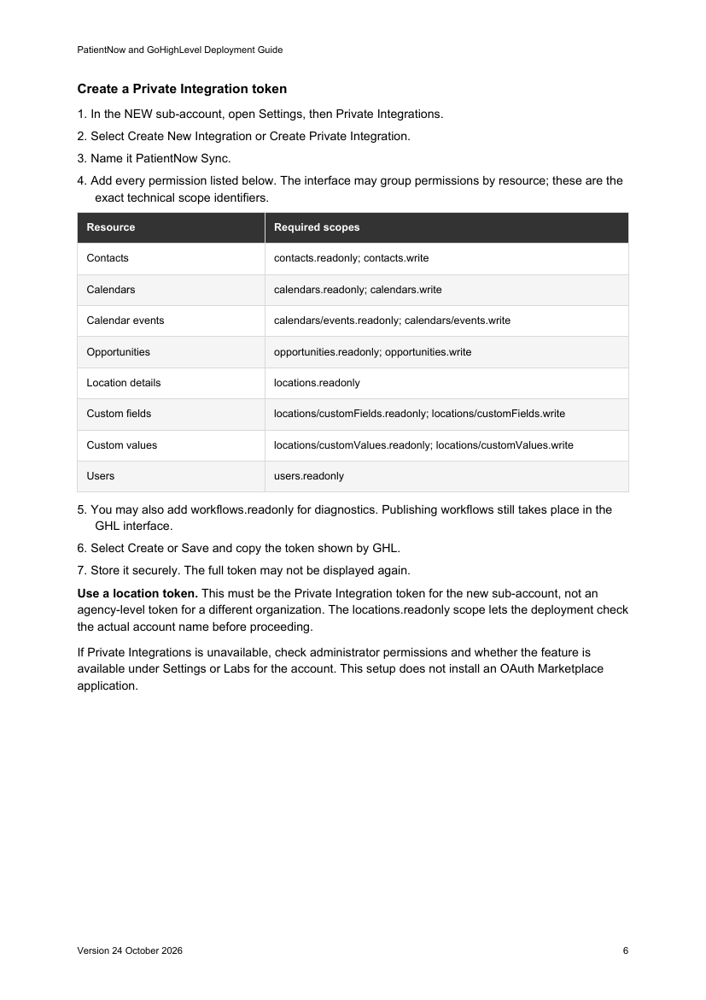
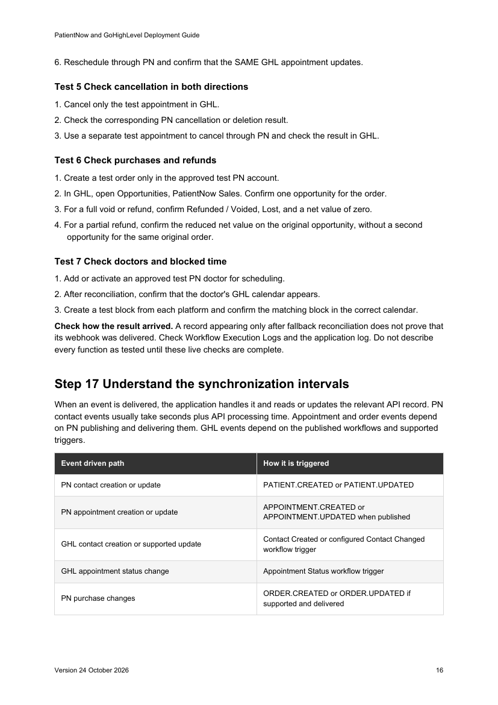

# PatientNow ↔ GoHighLevel

Contact and appointment sync

I built a synchronization backend designed to keep contact and appointment records consistent between PatientNow and GoHighLevel, with checks for repeated events and recovery from missed updates.

## User problem

Staff working in PatientNow and GoHighLevel need the same contact details and appointments in both places. Different record identifiers, repeated notifications and missed changes make it difficult to know which record to update.

## Designed benefit

The service is designed to reduce entering the same contact or appointment twice. It checks whether a change has already been handled and periodically compares records to catch missed updates. Unclear matches and conflicting edits are reported for review.

## Implementation

**My role:** Backend services, event normalization, identity resolution, synchronization rules, reconciliation, regression tests and deployment definitions. I also prepared an English operations and setup guide for handoff.

**Technology:** TypeScript, Node.js, Fastify, Axios, Zod, AWS SQS FIFO, DynamoDB, EFS, ECS/Fargate deployment definitions, Terraform, Docker.

## Architecture

Simplified implementation diagram, not a screenshot of production infrastructure.

## Engineering decisions

### Order events before resolving identity

The two providers assign different record IDs. The queue therefore orders a tenant/entity-type stream instead of assuming that either provider ID is already a shared identity. The worker stops later messages in a failed group from overtaking the failure.

### Give processing a durable owner

DynamoDB conditional writes acquire a processing lease and distinguish processed duplicates from work already in progress. Failed or expired work can be retried. SQS visibility is renewed during long operations, and a message is removed only after successful processing.

### Refuse uncertain identity matches

Contact resolution checks persisted links, managed custom IDs and provider lookups. Ambiguous or conflicting matches fail visibly rather than choosing the first candidate. Pending-create state supports recovery when a provider may have created a record but its response did not contain an ID.

### Treat time and cancellation as domain state

Appointment handling includes authoritative rereads, timezone normalization, echo suppression and cancellation tombstones. Moving an appointment uses create, verify and delete with a rollback path because the source API does not expose the needed update operation.

### Recover from missing events

Paginated reconciliation compares linked records and checkpoints instead of assuming every webhook arrives. Provider-calendar and blocked-time reconciliation handles changes not represented by the selected webhook systems. Concurrent edits to a blocked-time record are surfaced as conflicts.

### Represent sales without duplicating revenue

A PatientNow order maps to a CRM opportunity through a persisted order-ID link. Voids and full or partial refunds update the associated representation. Purchases flow from PatientNow to GHL; this is not a bidirectional payment-processing system.

## Interface and workflow

Excerpt from the 24 October 2026 deployment guide: scoped configuration and account-specific setup. Documentation example, not a live system capture.

Excerpt from the 24 October 2026 deployment guide: acceptance checks for cancellation, refunds, provider calendars and blocked time. These are test instructions, not a claim that each live check has passed.

## Validation and scope

- **74 offline tests.** An isolated verification run dated 29 October 2026 passed 74 tests across 18 files with outbound networking blocked. This is historical regression evidence, not a fresh live end-to-end run.
- **24-page operations guide.** Prepared an English deployment and handoff guide covering setup, configuration and operations.

The current design deliberately uses one writer worker over EFS identity/history state. API replicas scale separately. A complete live cross-platform run, HIPAA certification, uptime and business-volume metrics are not claimed.

Current local implementation is broader than the earlier public source snapshot.

[View the earlier public implementation](https://github.com/MeguMax/PN---GHL)

The saved test and acceptance records are dated evidence, not new runs performed for this portfolio.

[All selected work](../README.md) · [Visual portfolio](../index.html)

Updated 7 November 2026. Cover: conceptual illustration.
