# Client portfolio — all 19 Upwork entries

These entries retain their original source links. Similar workflows are presented separately because they are separate published portfolio records; this is not a count of new backend systems.

## Notion to GoHighLevel contact sync

**Automation and API integration**

I connected a Notion contact database to GoHighLevel through a Make scenario. The workflow maps fields, searches for an existing contact, and chooses an update or create operation. Webhook triggers, error logging and notifications make the sequence easier to follow and maintain. The described implementation sends changes from Notion to GHL; reverse synchronization was a possible extension.

**Tools:** Notion, GoHighLevel, Make, Webhooks, JSON mapping.

One-way contact synchronization through Make, with duplicate checks and field mapping.

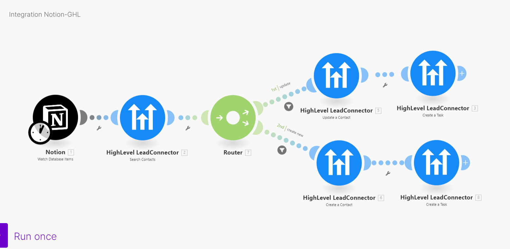

Notion-to-GoHighLevel contact lookup, create/update and task workflow.

[Original Upwork portfolio entry](https://www.upwork.com/freelancers/~014b478981bfacdaf1?p=2110337539072770048)

Original title: Notion ↔ GoHighLevel CRM Integration and Automation via Make

## Coaching community and webinar funnel

**GoHighLevel funnels and CRM automation**

I built a GoHighLevel journey that connects community signup, discovery calls, webinars and program enrollment. Forms apply tags and segmentation so contacts enter the relevant booking or email sequence. Calendar integration, Zapier and webhooks connect registration to CRM updates, reminders and replay access. Custom HTML, CSS and JavaScript support responsive pages and conditional form behaviour.

**Tools:** GoHighLevel, Zapier, Webhooks, Calendar integration, HTML, CSS, JavaScript.

Community, booking and webinar workflows built on GoHighLevel.

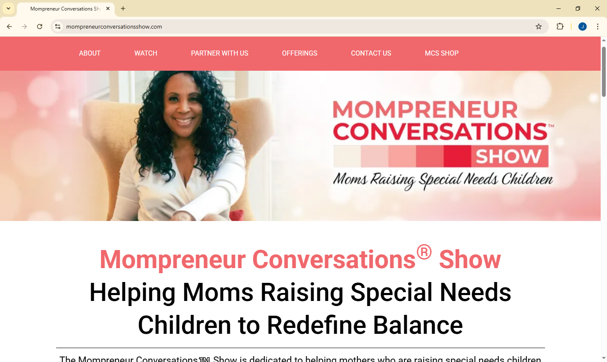

Mompreneur community homepage and branded hero section.

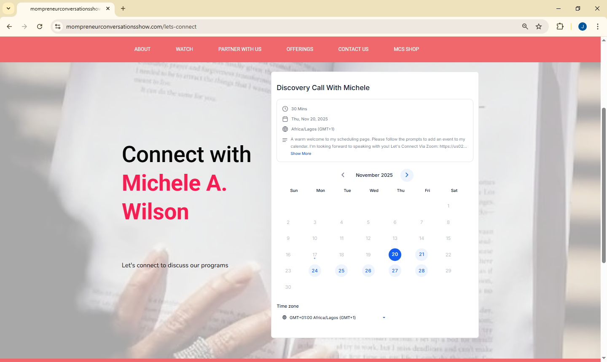

Public booking page with embedded discovery-call calendar.

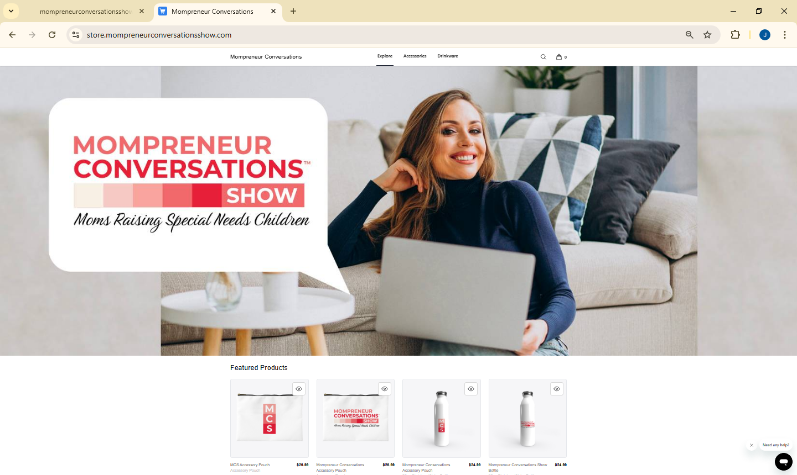

Branded merchandise storefront and product grid.

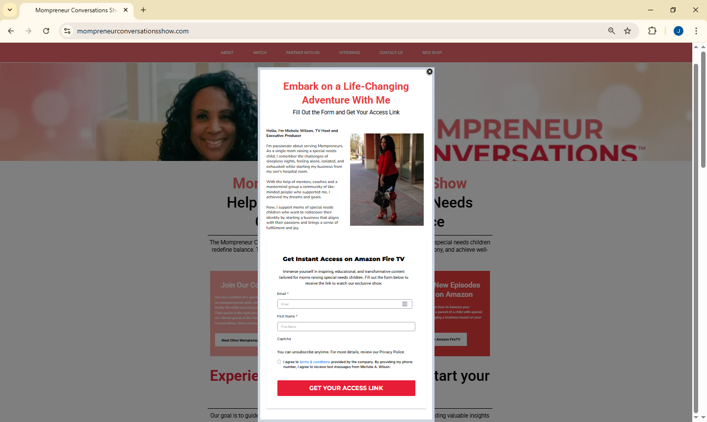

Lead-capture popup with an empty email and name form.

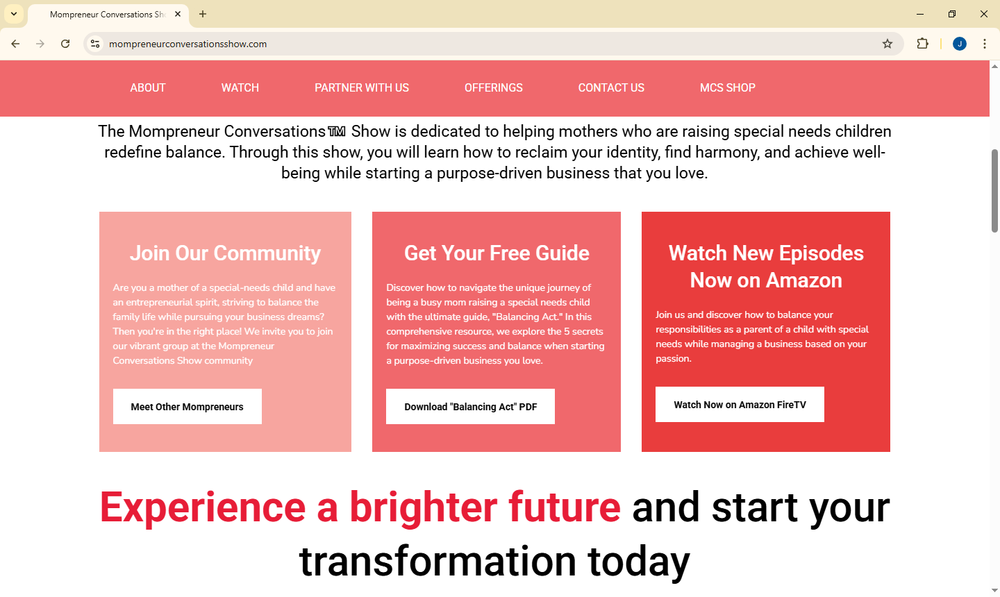

Community, guide and episode calls to action.

[Original Upwork portfolio entry](https://www.upwork.com/freelancers/~014b478981bfacdaf1?p=1998392639857852416)

Original title: GoHighLevel Funnel & CRM Automation for Mompreneur Coaching Community

## Executive coaching lead-magnet funnel

**Funnel migration and workflow integration**

I migrated a coaching lead-magnet journey from fragmented Systeme.io flows into GoHighLevel. Opt-in and thank-you pages connect ebook delivery to CRM tagging, nurture emails and booking follow-ups. Showit pages and calls to action follow the same journey, while Make, Google Sheets and analytics configuration support the surrounding workflow. The work combines page implementation, segmentation and integration setup.

**Tools:** GoHighLevel, Showit, Make, Google Sheets, GA4, GTM, HTML, CSS, JavaScript.

Lead-magnet migration, page alignment and CRM follow-up automation.

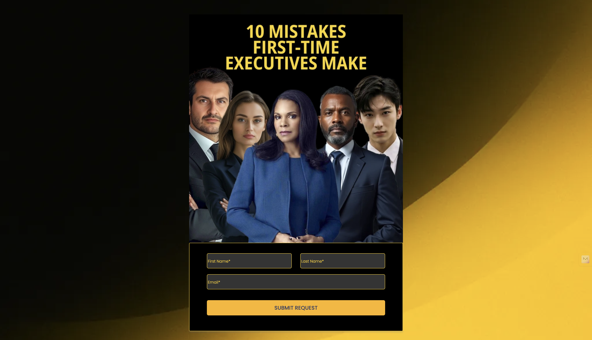

Executive-coaching lead-capture landing page with a blank form.

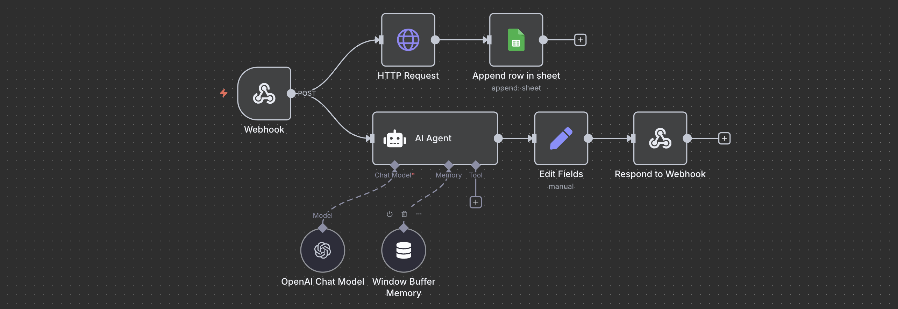

Webhook workflow with HTTP/Sheets and AI response branches.

[Original Upwork portfolio entry](https://www.upwork.com/freelancers/~014b478981bfacdaf1?p=2091895862459183104)

Original title: GoHighLevel Landing Page & CRM Automation for Executive Coaching

## White-label GoHighLevel workspace

**JavaScript and CSS interface customization**

I customized a white-label GoHighLevel interface with JavaScript and reusable CSS. The work covers navigation, dashboards, smart lists, contacts, opportunity views and enrollment pipelines. Shared styling and interaction patterns keep the workspace consistent across sub-accounts, while role-aware visibility changes which interface elements people see. This is customization of an existing platform; frontend visibility does not replace its backend authorization.

**Tools:** GoHighLevel, JavaScript, HTML, CSS, DOM integration, Naive UI, Tabulator.

Platform interface customization with reusable styling and role-aware visibility.

[Original Upwork portfolio entry](https://www.upwork.com/freelancers/~014b478981bfacdaf1?p=2054642433408012288)

Original title: GoHighLevel White-Label SaaS CRM Automation & UI/UX Optimization

## Interactive mortgage enquiry flow

**Interactive frontend and CRM-ready intake**

I designed a conversational mortgage enquiry flow that gathers service intent, property information, indicative financing needs and timing before contact details. A Vue.js single-page interface on AdsQuiz uses stepped questions, sliders and consent capture to organize the information. The flow prepares structured lead data for CRM delivery and segmentation, giving the enquiry a consistent format before the first conversation.

**Tools:** Vue.js, AdsQuiz, JavaScript, HTML, CSS, GoHighLevel, API integration.

Interactive enquiry collection and integration-ready lead delivery.

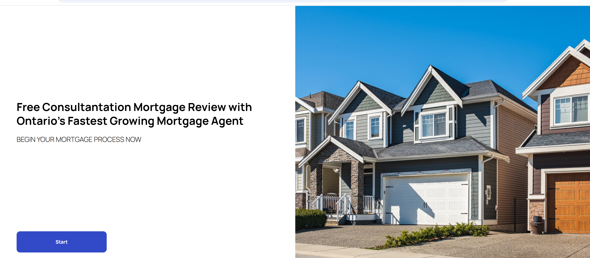

Mortgage consultation funnel introduction.

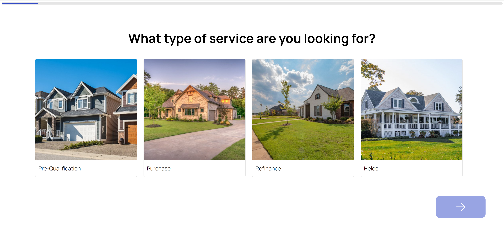

Mortgage-service selection step.

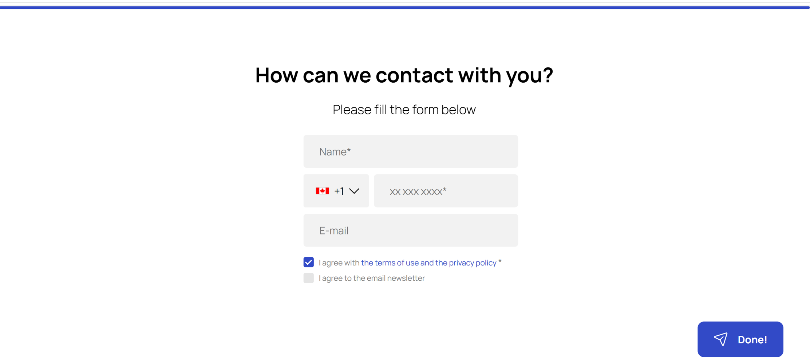

Contact form and consent controls at the final funnel step.

[Original Upwork portfolio entry](https://www.upwork.com/freelancers/~014b478981bfacdaf1?p=2105280224797556736)

Original title: Interactive Mortgage Lead Funnel | CRM Automation & Lead Generation

## Fitness webinar and replay automation

**Funnel and automation implementation with a designer**

I implemented the automation side of a webinar sales journey alongside a designer. GoHighLevel pages cover registration, the live session, replay, sales offers and checkout. ActiveCampaign lists, tags and behavioural states distinguish registered, attended, missed and purchased contacts, driving different reminders and follow-ups. Stripe and PayPal integrations and GA4 event setup connect the marketing workflow to its checkout stages.

**Tools:** GoHighLevel, ActiveCampaign, Stripe, PayPal, GA4, Email automation.

Webinar and replay workflows with ActiveCampaign segmentation and checkout integration.

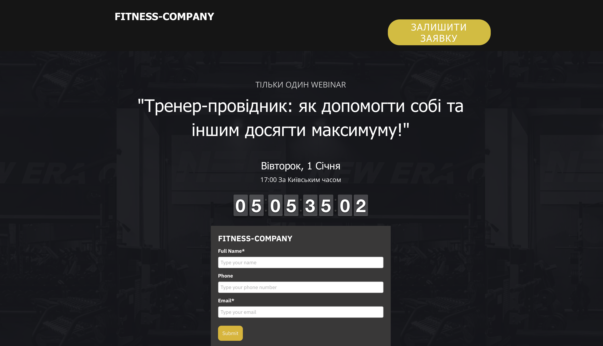

Fitness webinar registration page with a blank contact form.

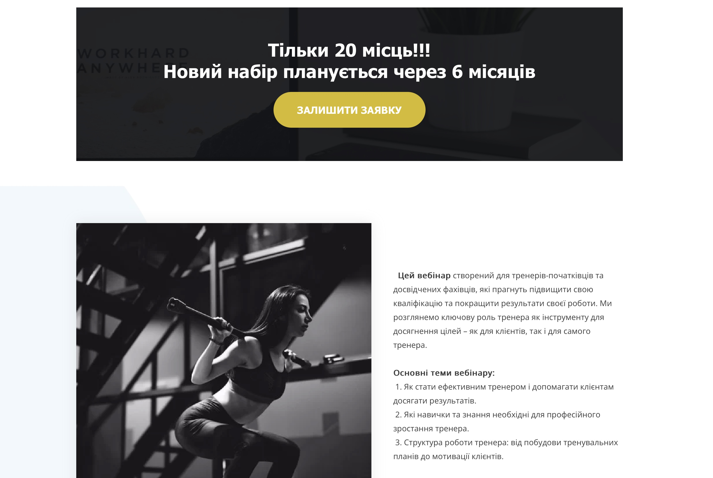

Fitness webinar offer and course-content section.

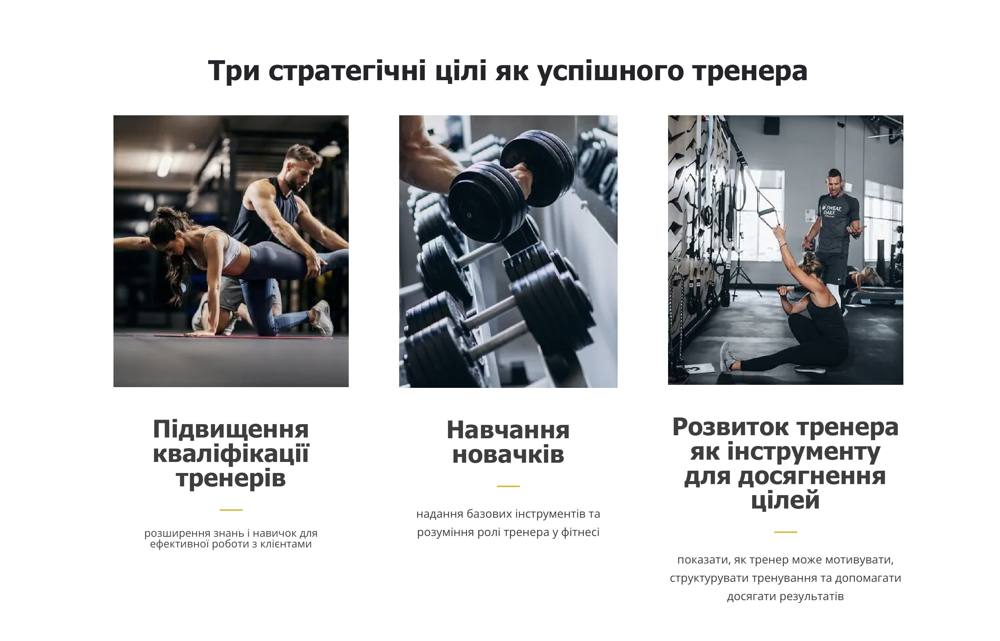

Fitness webinar learning-goals section.

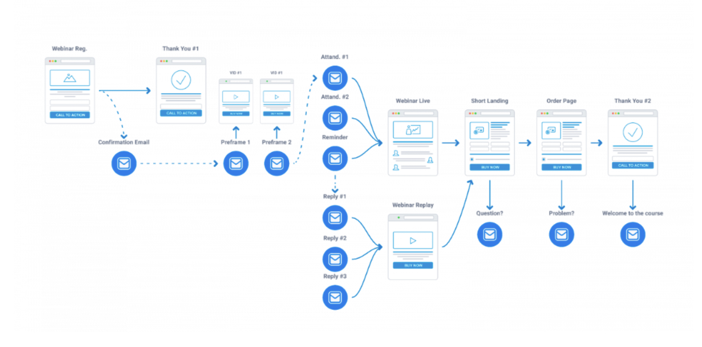

Published webinar-funnel concept diagram.

[Original Upwork portfolio entry](https://www.upwork.com/freelancers/~014b478981bfacdaf1?p=2096955411710705664)

Original title: GHL Funnel Builder for Fitness Coach | Webinar & Marketing Automation

## Business-coach booking funnel

**Frontend, booking and CRM workflow integration**

I connected responsive coaching pages, consultation forms and chat capture to a GoHighLevel booking workflow. CRM tags and pipeline stages organize contacts as booking and follow-up events arrive. Zapier, webhooks and Twilio connect calendar updates, confirmations, reminders and segmented email or SMS sequences. Custom HTML, CSS and JavaScript support the page layout and form behaviour around that journey.

**Tools:** GoHighLevel, Zapier, Webhooks, Twilio, HTML, CSS, JavaScript, GA4, GTM.

Website, consultation booking, chat capture and CRM follow-ups.

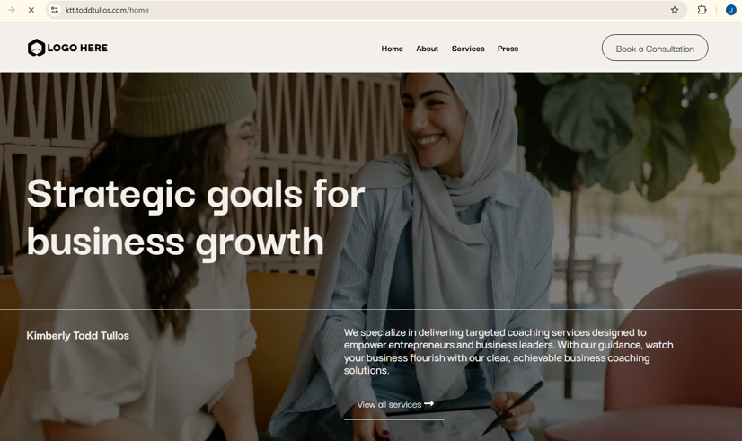

Business-coaching homepage and consultation call to action.

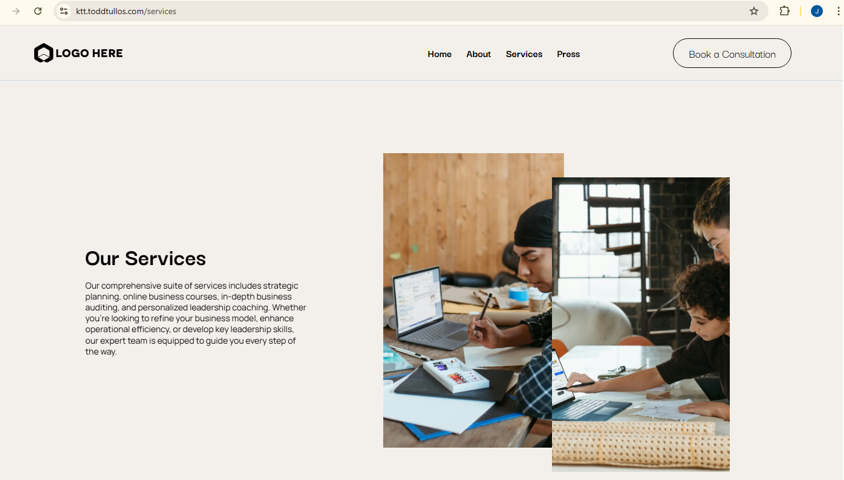

Business-coaching services page.

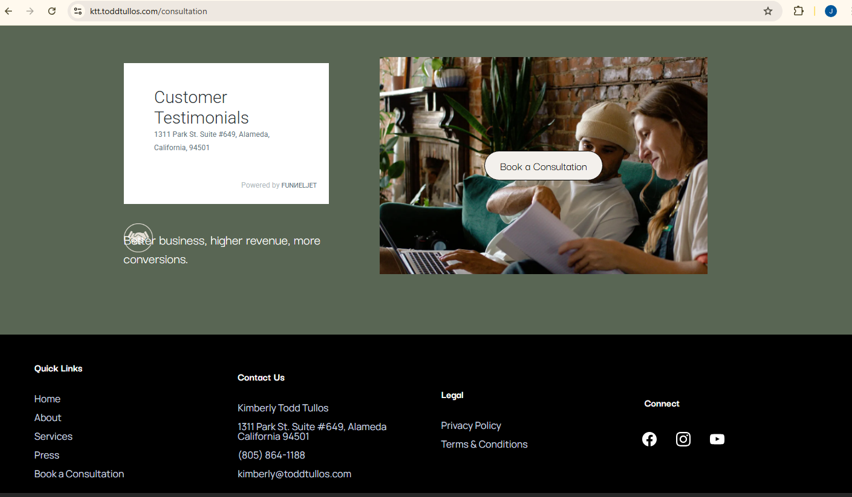

Consultation call to action and public business-contact footer.

[Original Upwork portfolio entry](https://www.upwork.com/freelancers/~014b478981bfacdaf1?p=1995878684624539648)

Original title: GoHighLevel Funnel for Business Coach | CRM Automation, Booking, API

## Merchant onboarding and CRM automation

**CRM setup and payment-triggered workflow integration**

I connected a merchant-services CRM workflow to Stripe payment events and onboarding communication. GoHighLevel pipelines, tags and responsive forms organize the customer journey, while Zapier and webhooks trigger CRM updates, team alerts and Twilio messages. The work brings payment-event notifications and follow-up steps into the CRM, keeping the onboarding sequence connected to the contact and its current pipeline stage.

**Tools:** GoHighLevel, Stripe, Twilio, Zapier, Webhooks, JavaScript, HTML, CSS.

Payment-event and onboarding workflows around GoHighLevel and Stripe.

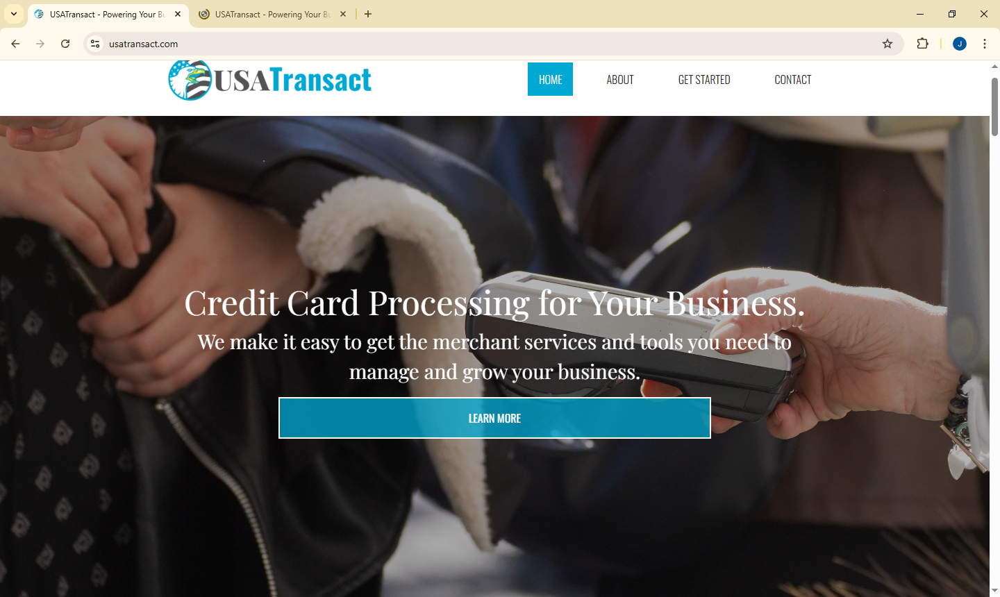

Merchant-services homepage and payment-processing offer.

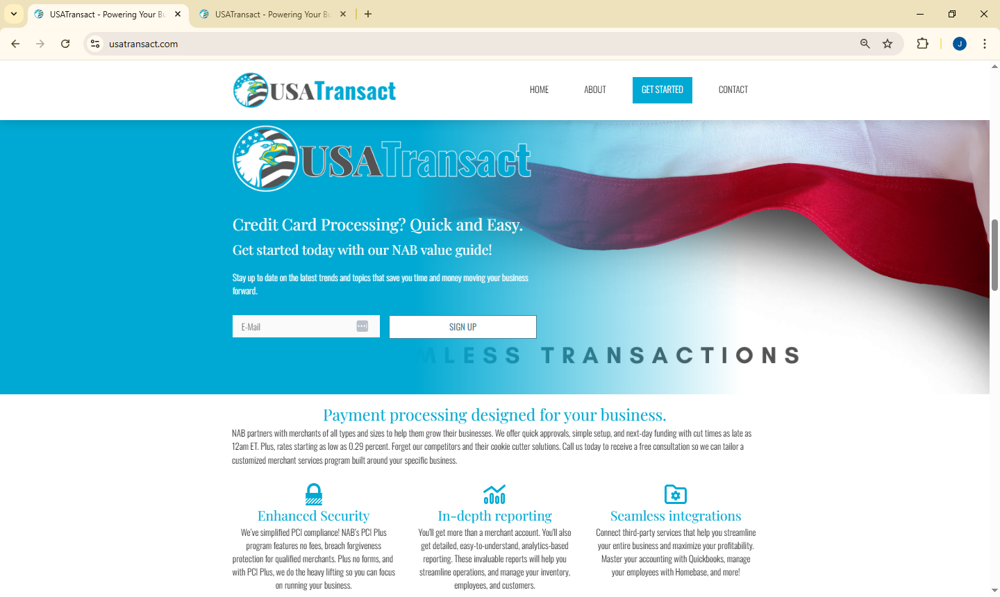

Merchant-services lead-capture page with an empty email field.

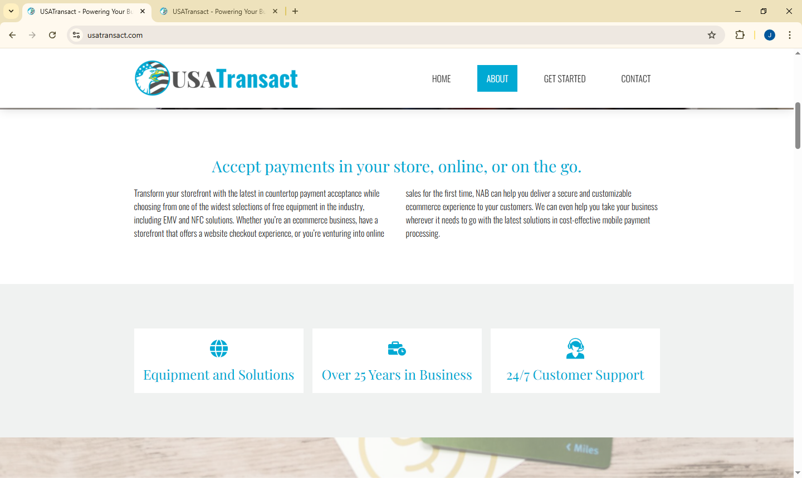

Merchant-services content and service highlights.

[Original Upwork portfolio entry](https://www.upwork.com/freelancers/~014b478981bfacdaf1?p=1991157873461620736)

Original title: GoHighLevel CRM Automation & Stripe Payment Integration | B2B Fintech

## Gift-order and delivery workflows

**GoHighLevel and external-service integration**

I built a branded gift-order funnel that connects CRM tagging, payment-event logic, scheduling and customer communication. GoHighLevel manages the funnel and workflow stages, with Stripe, Twilio, Zapier and webhooks linking the surrounding services. Custom page and form code supports the order journey. Customer messages and delivery-related follow-ups are attached to the relevant order stage through the connected workflow.

**Tools:** GoHighLevel, Stripe, Twilio, Zapier, Webhooks, HTML, CSS, JavaScript.

Gift-order funnel, scheduling links and customer communication automation.

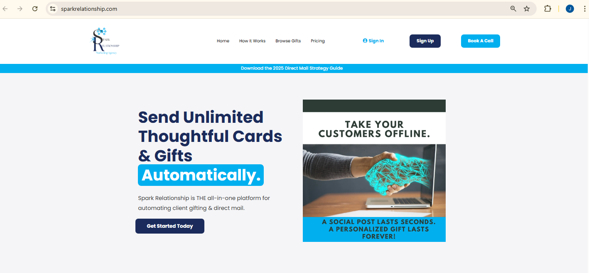

Gift-delivery platform homepage and signup calls to action.

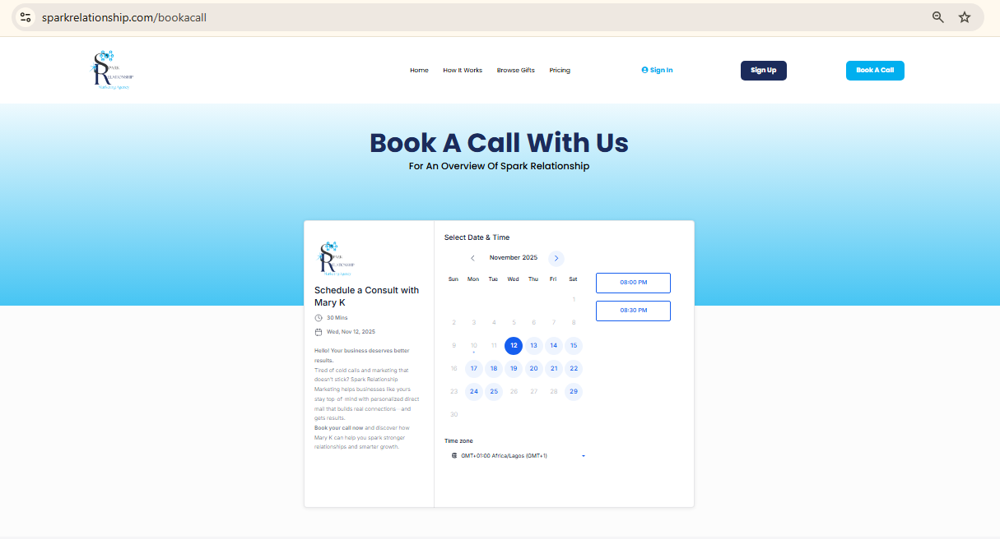

Public consultation calendar for the gift-delivery platform.

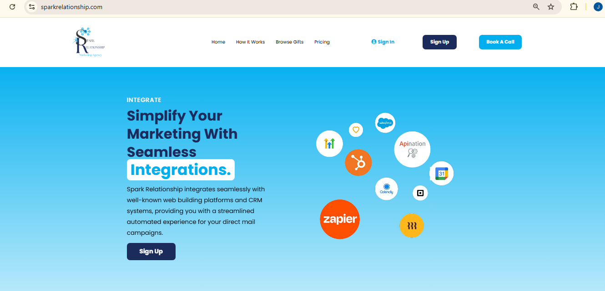

Gift-delivery website integration-marketing section.

[Original Upwork portfolio entry](https://www.upwork.com/freelancers/~014b478981bfacdaf1?p=1988622094966190080)

Original title: GoHighLevel Automation Funnel for Gift Delivery (CRM API SMS Zapier)

## Restaurant reservations and dynamic menu

**GoHighLevel frontend and booking workflows**

I built a responsive restaurant website in GoHighLevel with a categorized JavaScript menu and reservation forms. Form submissions connect to CRM records and workflow triggers, followed by booking confirmations and reminders through email or SMS. The implementation combines platform editing with custom HTML, CSS and JavaScript, keeping the menu, mobile layout and reservation journey within one maintainable website.

**Tools:** GoHighLevel, HTML, CSS, JavaScript, CRM workflows, SMS/email automation.

Restaurant website, reservation forms and confirmation workflows.

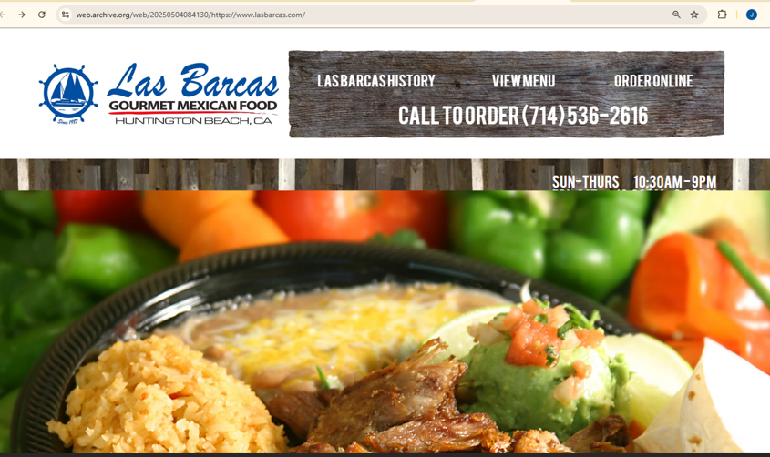

Archived restaurant homepage with menu and online-order navigation.

[Original Upwork portfolio entry](https://www.upwork.com/freelancers/~014b478981bfacdaf1?p=1996231600239800320)

Original title: GoHighLevel Restaurant Booking Website | CRM, HTML, CSS & JavaScript

## Custom CRM dashboard and pipeline

**React frontend and Node.js backend development**

This is the custom CRM project also shown as CRM-KP in my application work. It combines a React and TypeScript dashboard, client forms, a Kanban sales pipeline and centralized Redux state with an Express backend. The source includes Slack and email service modules. It remains a development snapshot, with authentication integration and demonstration adapters needing alignment before complete production use.

**Tools:** React, TypeScript, Redux Toolkit, Material UI, Node.js, Express, Slack Web API, Nodemailer.

The existing CRM-KP project, presented here through its published Upwork case.

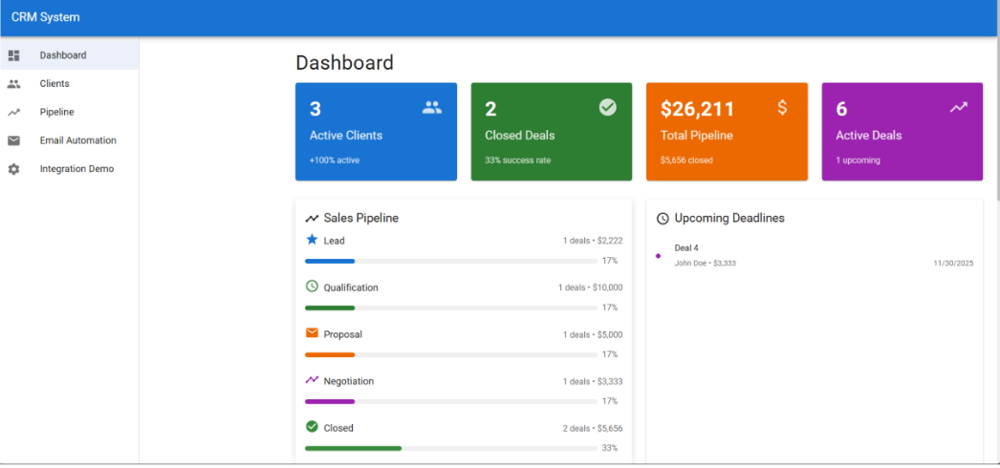

CRM dashboard with sample sales-pipeline data.

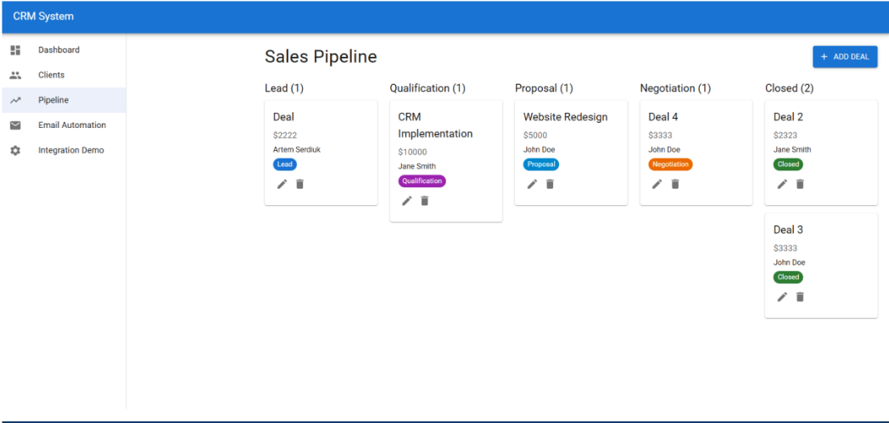

CRM Kanban pipeline with sample deals.

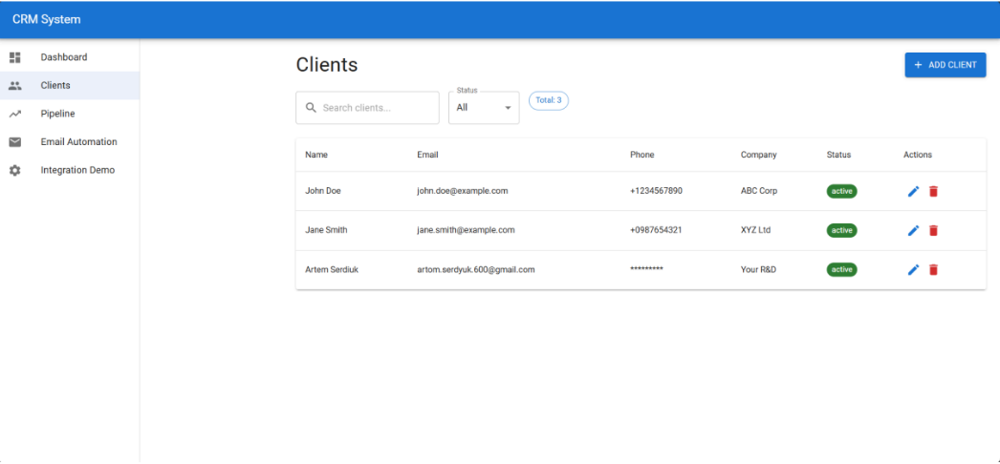

CRM client table with sample records.

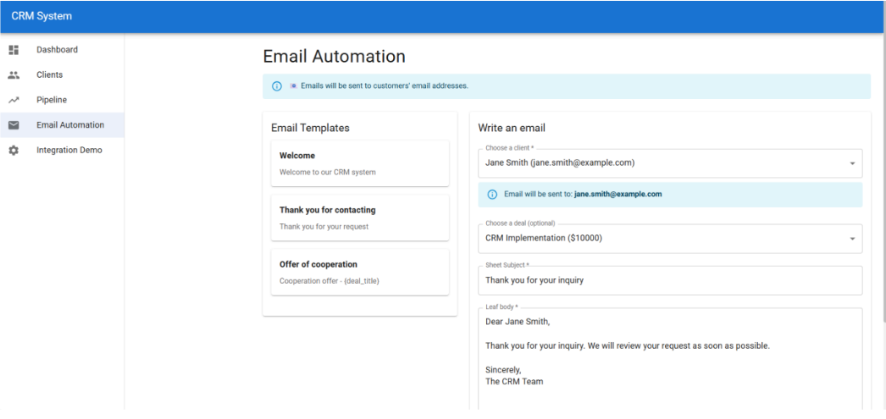

CRM email-template and compose interface.

[Original Upwork portfolio entry](https://www.upwork.com/freelancers/~014b478981bfacdaf1?p=2007049514782806016)

Original title: Custom CRM Development | Marketing Automation, CRM Automation & API

## Construction quote intake and routing

**Service website and CRM workflow implementation**

I connected a construction-services website and quote-request forms to an operational GoHighLevel pipeline. Enquiries move through estimate, scheduled, in-progress and completed stages, with tags, assignments and calendar links tying each request to the next action. Zapier and webhooks connect form capture to CRM updates, while confirmation and follow-up messages support the enquiry, estimate and scheduling portions of the workflow.

**Tools:** GoHighLevel, HTML, CSS, JavaScript, Zapier, Webhooks, Email/SMS, GA4, GTM.

Service enquiries, quotation stages and scheduling-related CRM workflows.

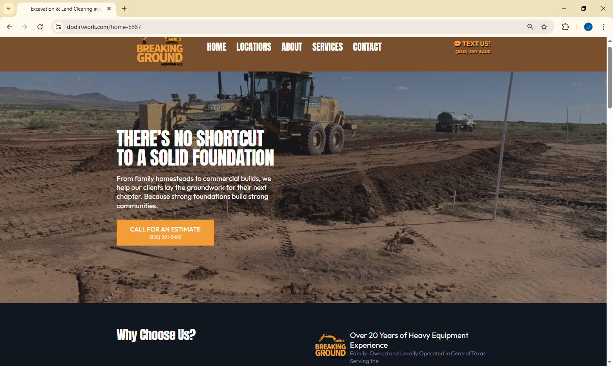

Construction-services homepage and estimate call to action.

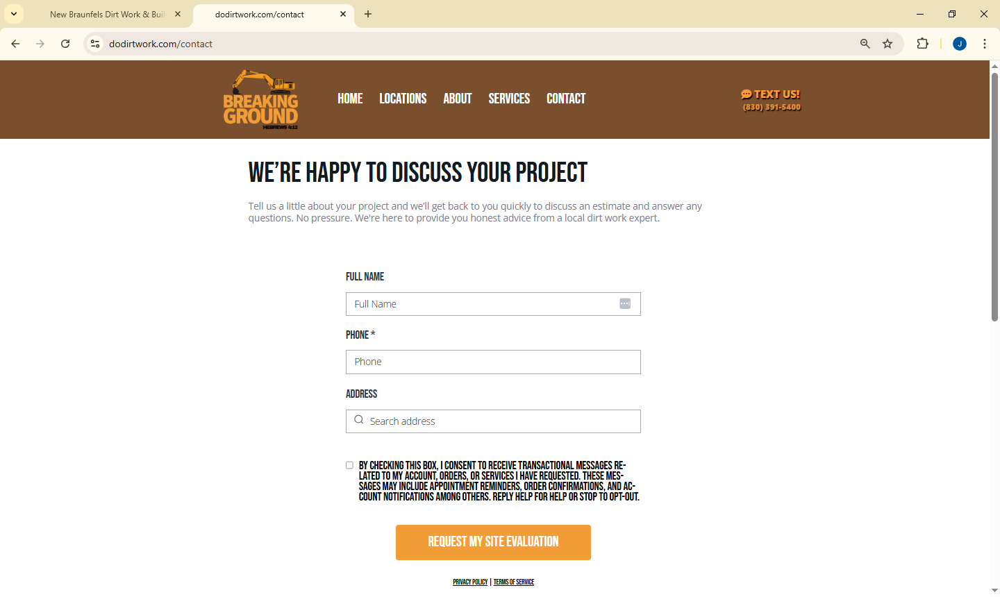

Construction estimate-request form with blank inputs.

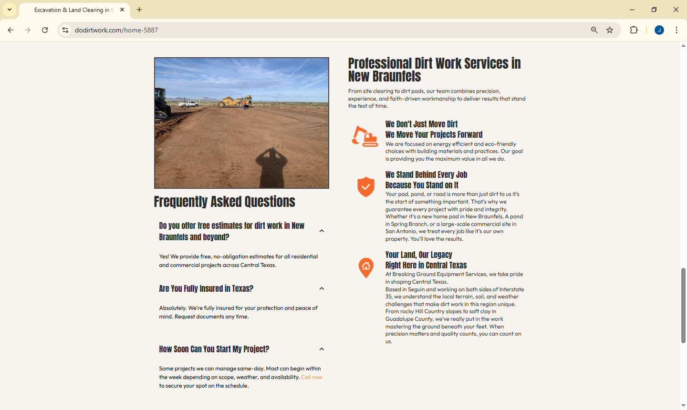

Construction service details and FAQ layout.

[Original Upwork portfolio entry](https://www.upwork.com/freelancers/~014b478981bfacdaf1?p=1995508211760467968)

Original title: GoHighLevel CRM Automation, Lead Generation, Workflow for Construction

## Vacation rental booking and calendars

**GoHighLevel frontend and booking automation**

I built rental pages and booking or enquiry forms that connect to GoHighLevel CRM pipelines and guest communication workflows. Google Calendar integration, Zapier and webhooks support availability updates alongside confirmations, reminders and follow-ups. Custom HTML, CSS and JavaScript provide the responsive frontend. The described project focuses on booking and calendar coordination; checkout and additional guest services were possible extensions.

**Tools:** GoHighLevel, HTML, CSS, JavaScript, Google Calendar API, Zapier, Webhooks, Twilio, GA4, GTM.

Rental frontend, guest communication and calendar integration.

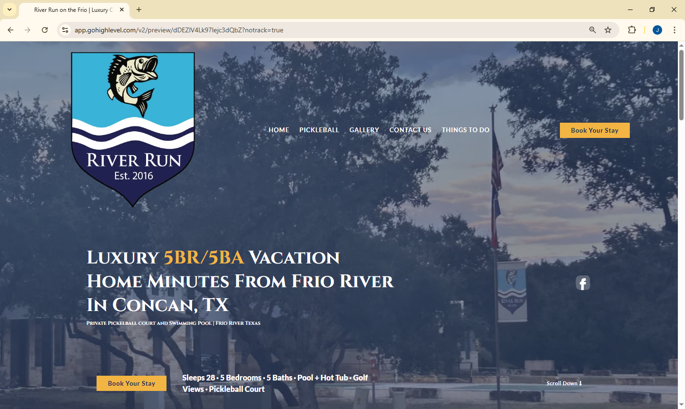

Vacation-rental homepage in the GoHighLevel preview.

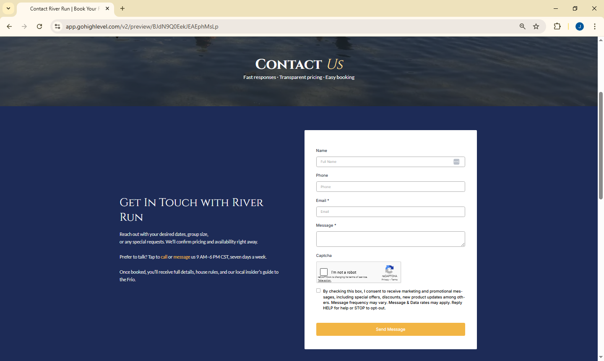

Vacation-rental enquiry form with blank guest fields.

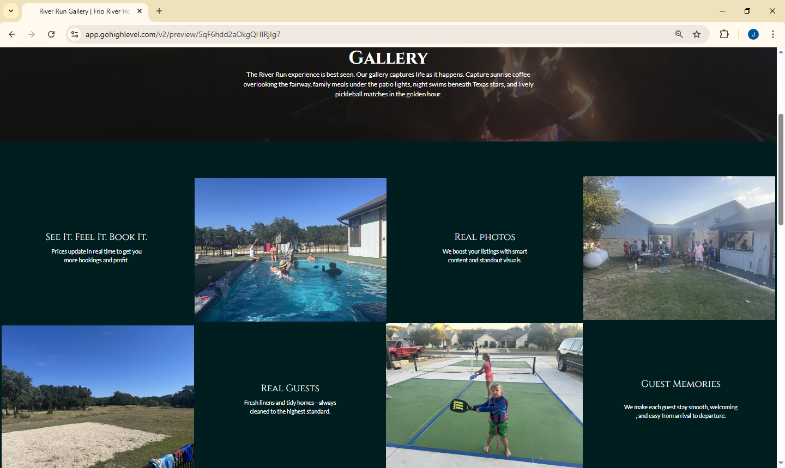

Vacation-rental activity and guest-gallery layout.

[Original Upwork portfolio entry](https://www.upwork.com/freelancers/~014b478981bfacdaf1?p=2000942337346359296)

Original title: GoHighLevel Website for Vacation Rentals | Booking CRM Automation API

## Professional service-request intake

**Responsive frontend and CRM-connected forms**

I built a responsive landing page and multi-step request forms for a professional-services workflow. Submitted information maps into GoHighLevel custom fields, tags, pipelines and opportunities, with routing, internal notifications and follow-up sequences. React, JavaScript, HTML and CSS support the interface, while Zapier and webhooks connect the form to CRM operations. The form collects the information needed to categorize each request.

**Tools:** GoHighLevel, React, JavaScript, HTML, CSS, Zapier, Webhooks, Form Builder.

Service-request forms, field mapping and CRM routing.

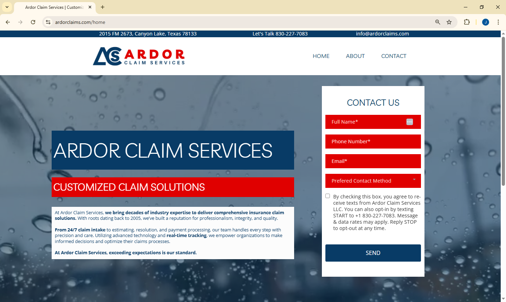

Service-request homepage with a blank enquiry form.

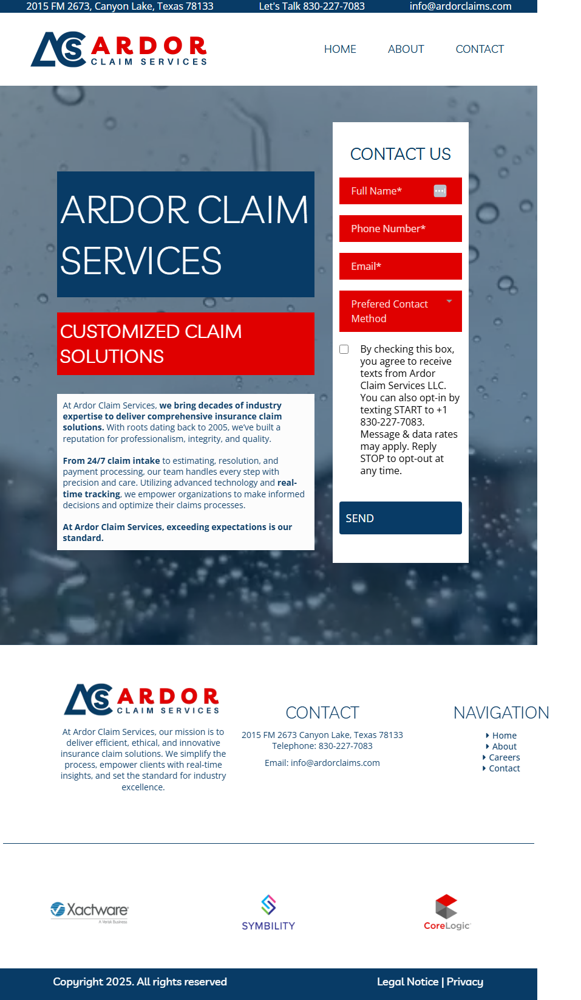

Service-request page and public business footer.

[Original Upwork portfolio entry](https://www.upwork.com/freelancers/~014b478981bfacdaf1?p=2001679576824881152)

Original title: GoHighLevel Landing Page & Service Request Automation | HTML, CSS, API

## Event tickets and merchandise sites

**Dual-site frontend and CRM/payment workflow setup**

I built two connected GoHighLevel websites for event tickets and merchandise, using a shared CRM to keep the purchase journeys organized. Stripe payment events, Zapier and CRM workflows connect transactions to tags, confirmation or access emails and audience segmentation. Custom HTML, CSS and JavaScript support the responsive storefronts, with analytics configuration covering the ticket and merchandise paths.

**Tools:** GoHighLevel, Stripe, Zapier, HTML, CSS, JavaScript, CRM workflows, GA4, GTM, Meta Pixel.

Two platform-based storefronts connected through payment events and a shared CRM.

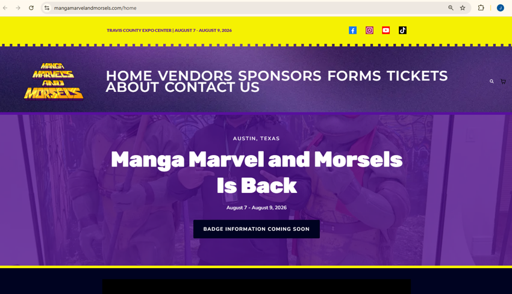

Entertainment-event homepage and ticket-navigation layout.

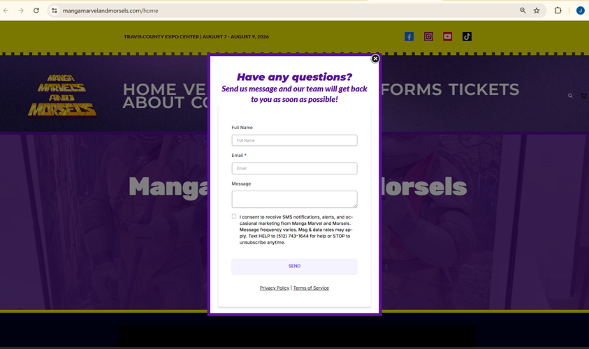

Event enquiry popup with empty contact fields.

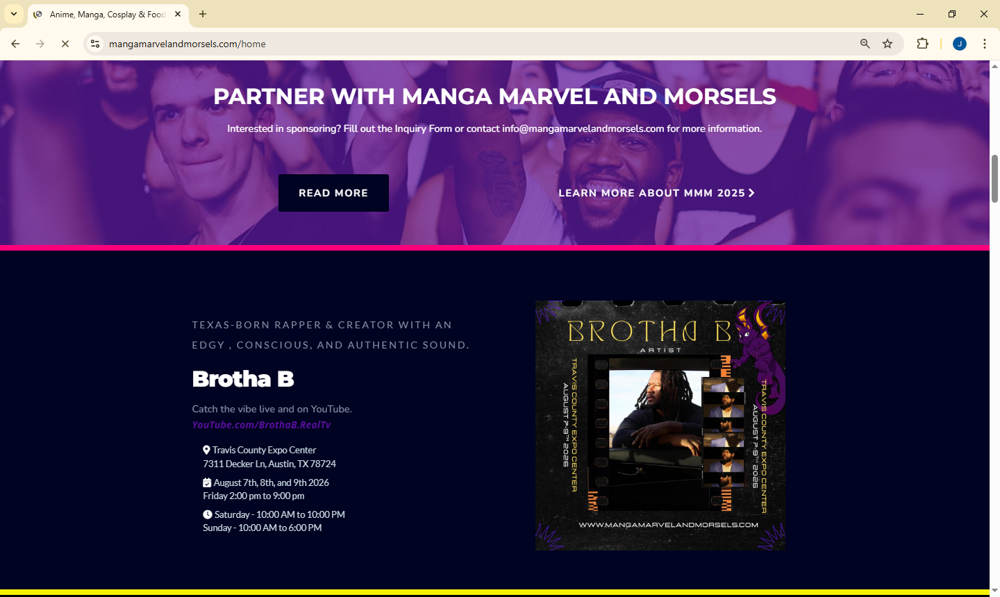

Event partnership and programme content section.

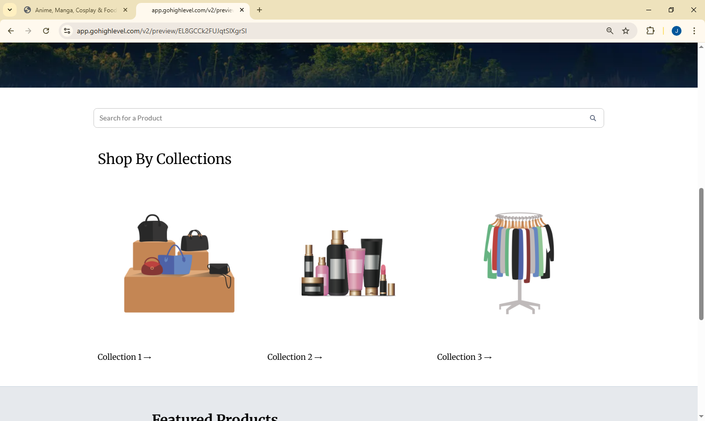

Ecommerce collection-grid preview for the entertainment project.

[Original Upwork portfolio entry](https://www.upwork.com/freelancers/~014b478981bfacdaf1?p=1998769231989415936)

Original title: GHL Dual-Site | E-Commerce & Event Ticketing System for Entertainment

## Rental booking pages with React logic

**GoHighLevel frontend and CRM-connected booking pages**

I built GoHighLevel rental landing pages with custom booking forms and React or JavaScript interface logic. Forms connect lead capture to CRM pipelines, tags and follow-up communication, while API integrations, Zapier and webhooks support calendar availability. The work combines responsive page implementation with workflow configuration, bringing property details, lead forms and booking-related communication into a consistent interface for prospective guests.

**Tools:** GoHighLevel, React, JavaScript, HTML, CSS, Zapier, Webhooks, API integration, GA4, GTM.

Rental pages, form behaviour and CRM-connected booking workflows.

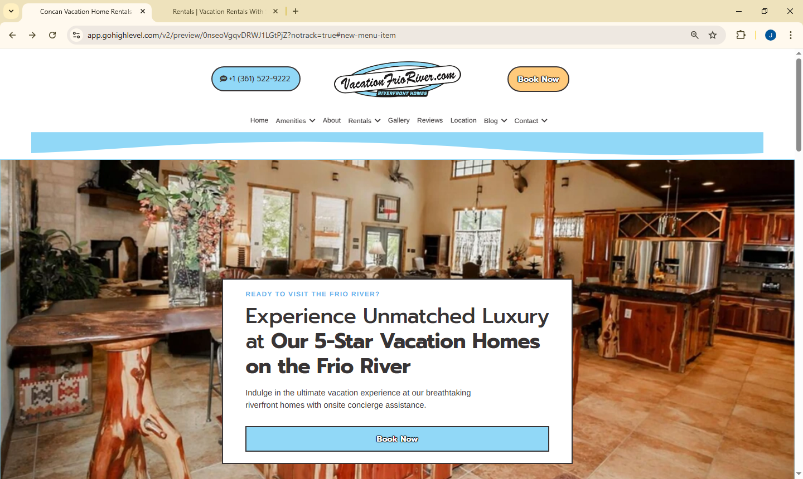

Vacation-rental homepage and booking call to action in GoHighLevel preview.

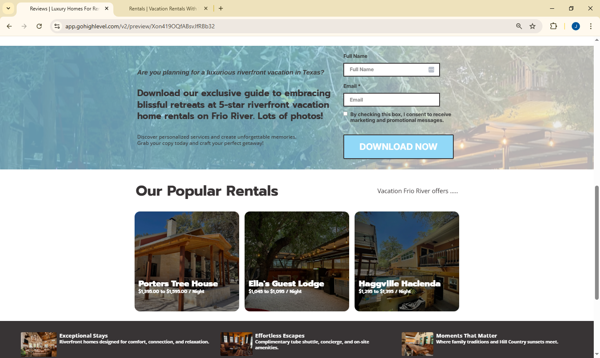

Vacation-guide lead-capture form and rental-card layout.

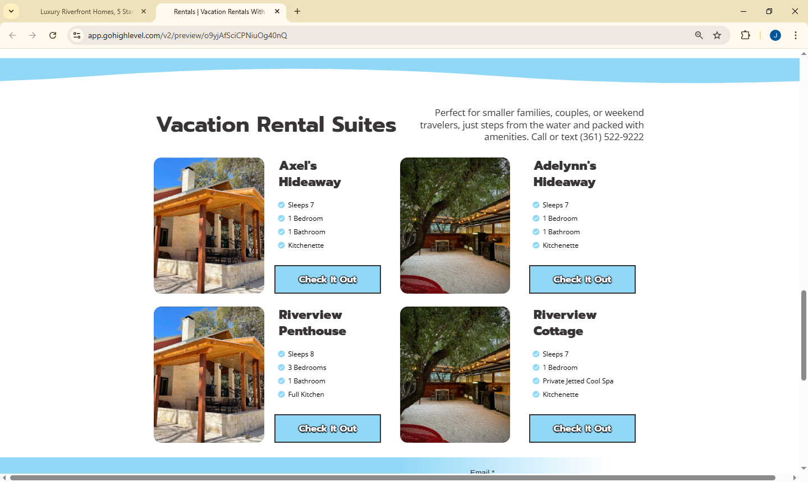

Rental-suite catalogue with amenities and detail links.

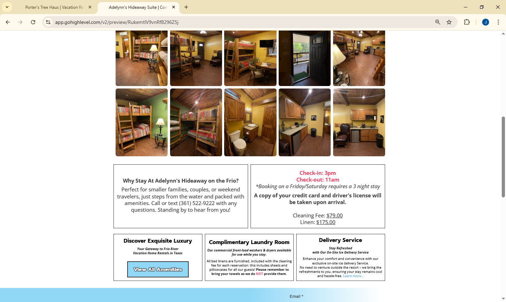

Rental-detail gallery, property information and amenity layout.

[Original Upwork portfolio entry](https://www.upwork.com/freelancers/~014b478981bfacdaf1?p=1999514259445223424)

Original title: GoHighLevel Booking Pages & CRM Automation | React HTML CSS JavaScript

## Coaching, training and speaking workflows

**Funnels, CRM segmentation and automation integration**

I built connected funnels for coaching, training and speaking services, with forms and tags routing contacts into the relevant journey. GoHighLevel pipelines and email sequences connect consultation booking, training-program checkout, onboarding, reminders and post-session follow-ups. Zapier, webhooks and custom HTML, CSS and JavaScript support the integrations and page behaviour. Each service line has its own lead classification and follow-up sequence.

**Tools:** GoHighLevel, Zapier, Webhooks, HTML, CSS, JavaScript, Booking workflows, Commerce workflows.

Service-specific lead routing, booking and training-program automation.

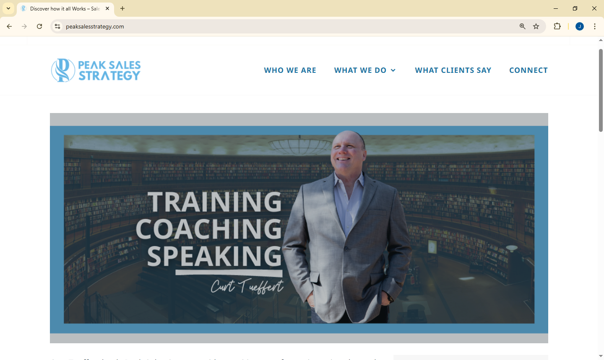

Sales-coaching homepage with branded hero and service navigation.

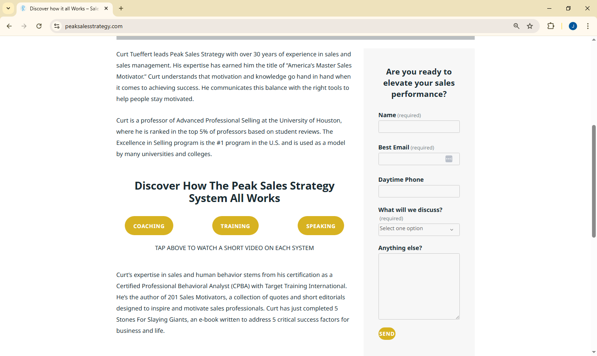

Sales-coaching service choices and blank enquiry form.

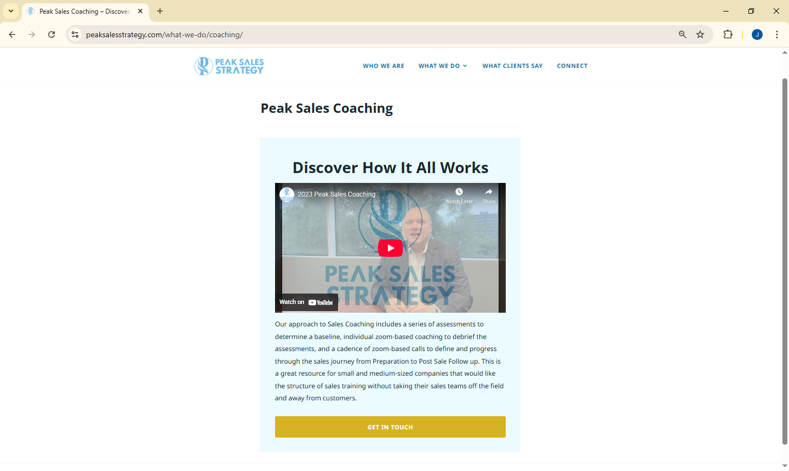

Coaching service page with embedded video and contact call to action.

[Original Upwork portfolio entry](https://www.upwork.com/freelancers/~014b478981bfacdaf1?p=1993712123571834880)

Original title: GoHighLevel Automation for Sales Coach | CRM, Funnels, API, HTML, CSS

## Custom restaurant menu and forms

**GoHighLevel website and custom JavaScript/CSS interface**

I built a restaurant website in GoHighLevel with a custom category-filtered menu written in JavaScript and CSS. Responsive pages connect ordering, catering and reservation enquiries to CRM segments, tags and internal notifications. The project demonstrates custom frontend behaviour inside a website platform, alongside practical form integration. Its published scope describes enquiry and order capture; online payments were a possible later addition.

**Tools:** GoHighLevel, JavaScript, HTML, CSS, Form Builder, CRM tags, Workflow notifications.

Custom JavaScript menu, responsive pages and CRM-connected enquiry forms.

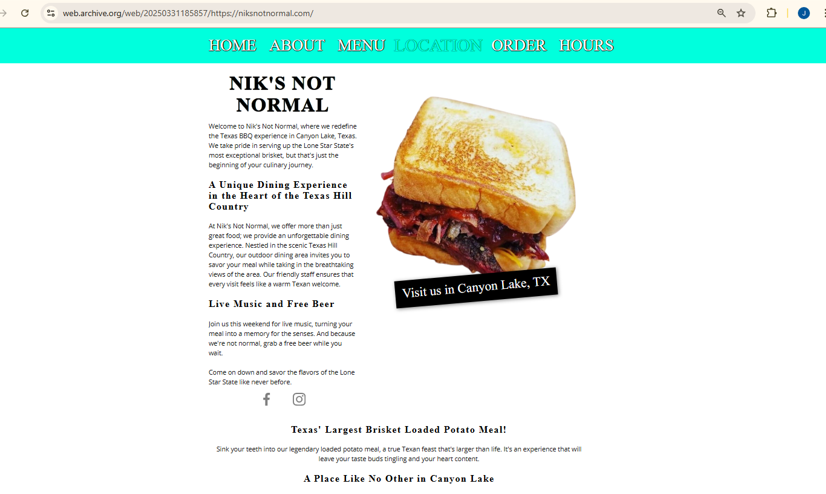

Archived restaurant homepage with food imagery and section navigation.

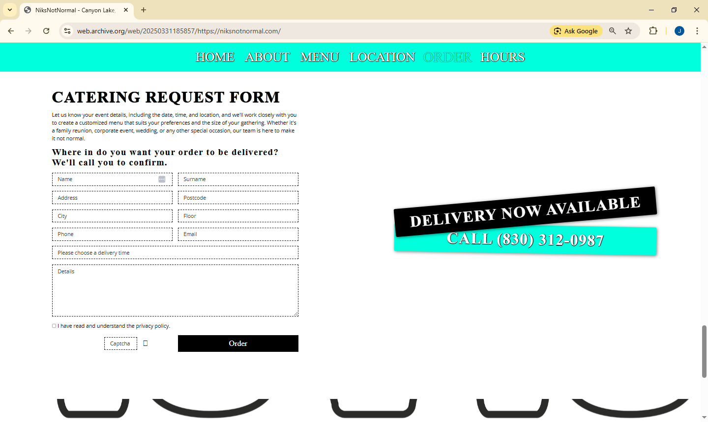

Archived catering request form with delivery and contact fields.

Archived restaurant menu and public image gallery.

[Original Upwork portfolio entry](https://www.upwork.com/freelancers/~014b478981bfacdaf1?p=1989001779622383616)

Original title: GohighLevel Website | Landing Page HTML CSS JavaScript for Restaurant

## Payment-triggered course access

**Funnel and automation integration**

I built a one-page course-sales funnel connecting Stripe checkout events to GoHighLevel CRM updates and access-email workflows. Zapier and webhooks link payment events to tags, welcome sequences and subsequent email or SMS follow-ups. Custom HTML, CSS and JavaScript support the responsive page and forms. The public case covers the integration flow; protected course content and client details remain private.

**Tools:** GoHighLevel, Stripe, Zapier, Webhooks, HTML, CSS, JavaScript, Email/SMS.

Course-sales funnel and payment-triggered onboarding; course content remains private.

Coaching lead-magnet landing page with video and guide call to action.

Guide-download modal with blank contact and consent fields.

Coaching landing-page overview, consultation call to action and testimonial section.

[Original Upwork portfolio entry](https://www.upwork.com/freelancers/~014b478981bfacdaf1?p=1990431490445197312)

Original title: GoHighLevel Automation | CRM Stripe Zapier Webhooks SMS & Coach Funnel

[All engineering work](../README.md) · [Visual portfolio](https://megumax.github.io/MeguMax/#client-work)
